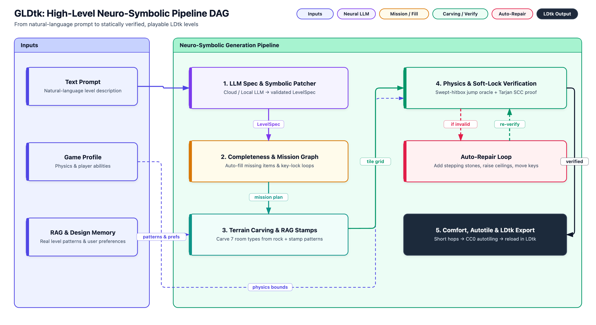
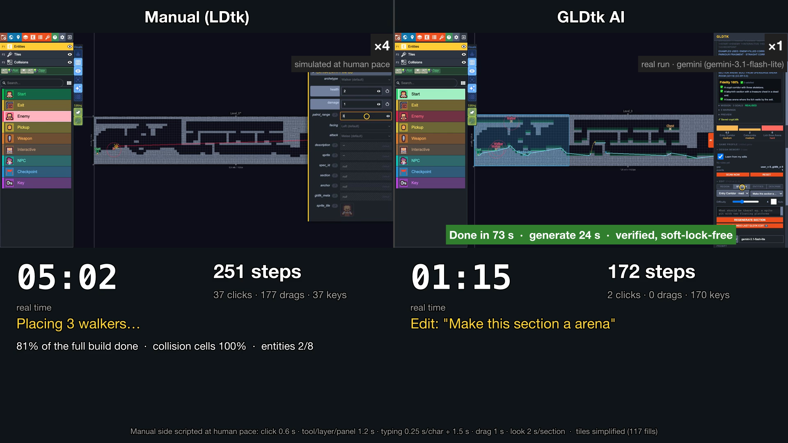

# GLDtk — Generative Level Design Toolkit

GLDtk turns a text prompt into a **playable, statically verified 2D platformer level** directly inside [LDtk](https://ldtk.io) via a native Haxe/Electron sidebar. An LLM handles creative structure and semantics, while deterministic terrain carving, a closed-form kinematic physics oracle, and Tarjan SCC soft-lock analysis guarantee every written level is beatable.

---

## How to Run on Desktop

### Fastest Way (1 Repo Clone + 1 Command, No Haxe Build)

```bash
git clone https://github.com/bekiryan/GLDtk.git
cd GLDtk
./start.sh
```

`start.sh` handles everything automatically on first launch — **you do not need to install Haxe or manually clone a second repo**:
1. Pulls the precompiled frontend execution files (`main.js` & `renderer.js`, already built and pushed in [`bekiryan/ldtk`](https://github.com/bekiryan/ldtk)) into `ldtk-src/`.
2. Creates `.venv` (`pip install -e ".[server]"`) and installs Electron packages (`npm install`) once.
3. Starts the Python backend (`http://127.0.0.1:8765`) and opens the LDtk desktop app. Set your free [Gemini API key](https://aistudio.google.com/apikey) (or local [Ollama](https://ollama.com)) inside the sidebar's **Settings** fold.

### Prebuilt Release Downloads (`v1.5.3`)

- **[GitHub Release `v1.5.3`](https://github.com/bekiryan/GLDtk/releases/tag/v1.5.3)** — download either:
  - **`gldtk-execution-bundle.zip`** (lightweight precompiled `main.js`, `renderer.js`, `release-notes.md`, and `start.sh` execution files only)
  - **`GLDtk-1.5.3-arm64.dmg`** (standalone macOS Apple Silicon app; drag **GLDtk** to Applications, right-click → **Open** on first run — or open the local copy at [`ldtk-src/app/redist/GLDtk-1.5.3-arm64.dmg`](ldtk-src/app/redist/GLDtk-1.5.3-arm64.dmg))
- Detailed install & manual Haxe rebuild steps (for editing LDtk UI itself): [`docs/USER_GUIDE.md`](docs/USER_GUIDE.md#2-installing)

### Run Tests & Offline Ablations

```bash
source .venv/bin/activate
pytest -q                               # full offline test suite (750+ tests)
python -m eval.ablation                 # offline replay ablation suite (A1–A5)
```

---

## Main Components

| Component | Path | Purpose |
|---|---|---|
| **LDtk Native Sidebar & Play Mode** | [`ldtk-src/`](ldtk-src/) | Haxe/Electron fork of LDtk 1.5.3 with prompt UI, area lasso, Route Overlay, Difficulty Curve, and 60 Hz Play Mode |
| **FastAPI Backend & Contracts** | [`server.py`](server.py), [`api/`](api/) | Local HTTP API (`:8765`) for generation, regional edits, route/difficulty inspection, chunks, and memory |
| **LLM Controller & Patcher** | [`llm/`](llm/), [`spec/`](spec/) | Schema-enforced `LevelSpec` generation (Gemini/Claude/Ollama fallback) + deterministic `SymbolicPatcher` |
| **Completeness & Fidelity** | [`fidelity/`](fidelity/), [`pipeline/completeness.py`](pipeline/completeness.py) | Prompt requirement extraction, single-tower collapse, deterministic fill, and 5-factor difficulty scoring |
| **Pipeline, Worlds & Chunks** | [`pipeline/`](pipeline/) | 11-stage orchestrator (`build_level`), closed-loop complexity tuning, multi-level worlds, endless chunks |
| **Terrain Carvers & Layout** | [`layout/`](layout/), [`layout/terrain/`](layout/terrain/) | 7 rock carvers (`corridor`, `parkour`, `labyrinth`, `arena`, `shaft`, `hub`, `open`), comfort pass, noise rock fill, LDtk 1.5.3 export |
| **Physics Oracle & Soft-Lock Solver** | [`symbolic/`](symbolic/), [`game/`](game/), [`layout/softlock.py`](layout/softlock.py) | Swept `12×24 px` hitbox kinematics (double jump, dash, wall kick, gravity) + Tarjan SCC & Item-State deadlock proof |
| **Mission Grammar & Regional Edit** | [`mission/`](mission/), [`edit/`](edit/) | Dormans lock-key/ability mission rewriting + seam-locked regional regeneration with 30-step undo history |
| **RAG Patterns & Design Memory** | [`patterns/`](patterns/), [`memory/`](memory/), [`aesthetic/`](aesthetic/) | 3,336 open-licensed pattern windows + cross-project edit preference learning + CC0 Kenney autotiles & sprites |
| **Evaluation & Demo Harness** | [`eval/`](eval/), [`demo/`](demo/) | 35-prompt benchmark suite, A1–A5 offline replay ablations, and side-by-side Playwright demo recorder |

---

## Architecture Diagrams (Draw.io)



- **All-in-one 3-page Draw.io workbook:** [`docs/architecture/gldtk_architecture_master.drawio`](docs/architecture/gldtk_architecture_master.drawio) · [Diagram gallery & SVG/PNG links](docs/architecture/README.md)
- **Pipeline DAG:** [`01_pipeline_dag.drawio`](docs/architecture/01_pipeline_dag.drawio) ([SVG](docs/architecture/01_pipeline_dag.svg) · [PNG](docs/architecture/01_pipeline_dag.png))
- **System Architecture:** [`02_system_architecture.drawio`](docs/architecture/02_system_architecture.drawio) ([SVG](docs/architecture/02_system_architecture.svg) · [PNG](docs/architecture/02_system_architecture.png))
- **Verification & Regional Editing Flows:** [`03_verification_and_mission_dags.drawio`](docs/architecture/03_verification_and_mission_dags.drawio) ([SVG](docs/architecture/03_verification_and_mission_dags.svg) · [PNG](docs/architecture/03_verification_and_mission_dags.png))

---

## Demo Video

[](docs/demo/comparison.mp4)

- **Side-by-side comparison (Manual 5m 57s / 311 steps vs. GLDtk AI 1m 13s / 172 steps — 4.89× speedup):** [`docs/demo/comparison.mp4`](docs/demo/comparison.mp4)
- **Full 1× recordings & stats:** [`docs/demo/ai_full.mp4`](docs/demo/ai_full.mp4) · [`docs/demo/manual_full.mp4`](docs/demo/manual_full.mp4) · [`docs/demo/stats.json`](docs/demo/stats.json) · [`docs/demo/SPEC.md`](docs/demo/SPEC.md)

---

## Thesis Paper & Documentation

- **Thesis Paper (PDF):** [`docs/thesis/GLDtk_Thesis_Paper.pdf`](docs/thesis/GLDtk_Thesis_Paper.pdf) ([Markdown](docs/thesis/THESIS_PAPER.md) · [LaTeX](docs/thesis/latex/main.tex) · [Overleaf zip](docs/thesis/gldtk_thesis_overleaf.zip))
- **Ablation & Evaluation Report:** [`eval/results/ablations/report.md`](eval/results/ablations/report.md)
- **User Guide (install, prompts, sidebar walkthrough):** [`docs/USER_GUIDE.md`](docs/USER_GUIDE.md)
- **Technical Reference (API endpoints, providers, CLI, troubleshooting, Mac build):** [`docs/TECHNICAL_REFERENCE.md`](docs/TECHNICAL_REFERENCE.md)
- **Roadmap, Status & Literature:** [`docs/thesis/PROJECT_STATUS_AND_ROADMAP.md`](docs/thesis/PROJECT_STATUS_AND_ROADMAP.md) · [`docs/thesis/LITERATURE_AND_SOURCES.md`](docs/thesis/LITERATURE_AND_SOURCES.md)
