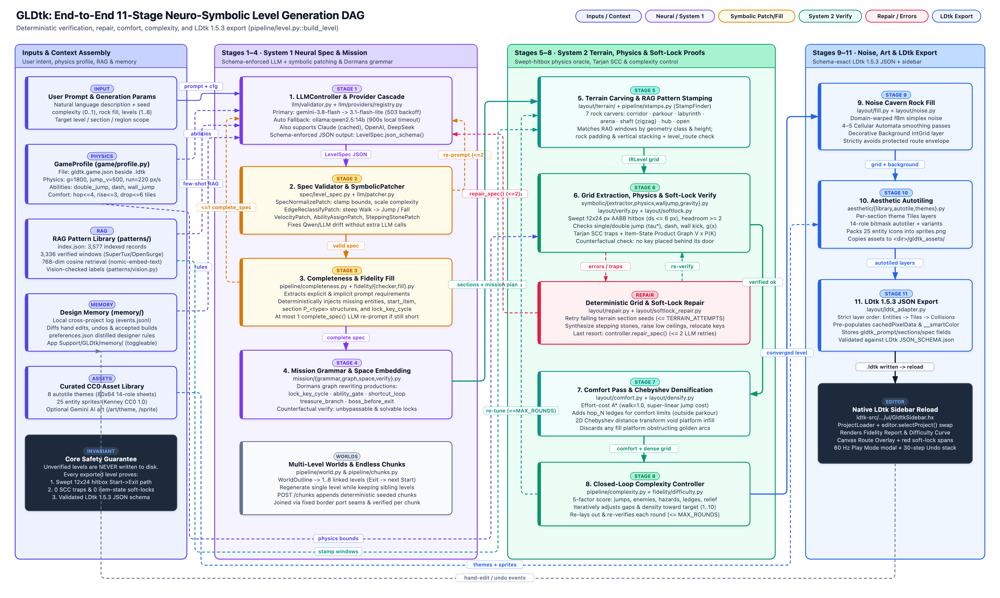
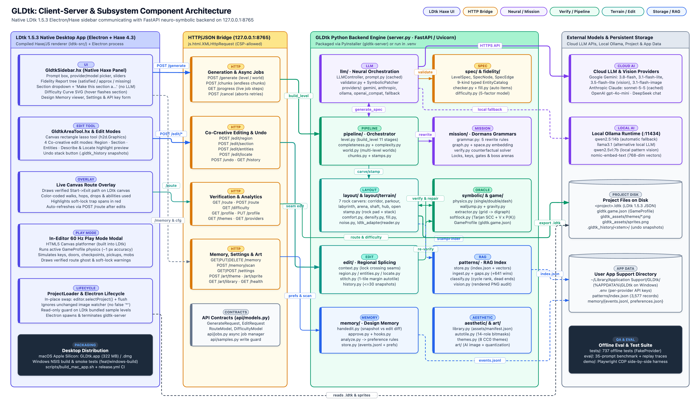
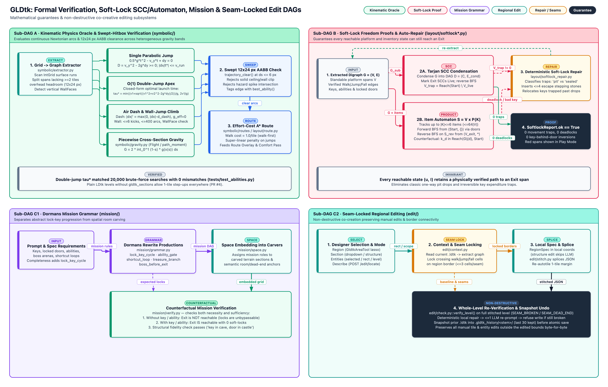

# GLDtk Architecture Diagrams & DAGs

Editable [diagrams.net (Draw.io)](https://app.diagrams.net) `.drawio` architecture diagrams and Directed Acyclic Graphs (DAGs) with companion SVG and PNG renders generated from [`scripts/generate_architecture_drawio.py`](../../scripts/generate_architecture_drawio.py).

## Files

| File | Description | Open / Edit |
|---|---|---|
| [`gldtk_architecture_master.drawio`](gldtk_architecture_master.drawio) | **All-in-one 3-tab Draw.io workbook** containing all three diagrams below | Draw.io Desktop / [app.diagrams.net](https://app.diagrams.net) |
| [`01_pipeline_dag.drawio`](01_pipeline_dag.drawio) | **End-to-End 11-Stage Neuro-Symbolic Pipeline DAG** (`pipeline/level.py::build_level`) | [SVG](01_pipeline_dag.svg) · [PNG](01_pipeline_dag.png) |
| [`02_system_architecture.drawio`](02_system_architecture.drawio) | **Client-Server & Subsystem Component Architecture** (LDtk Haxe UI ↔ FastAPI `:8765` ↔ Providers & Storage) | [SVG](02_system_architecture.svg) · [PNG](02_system_architecture.png) |
| [`03_verification_and_mission_dags.drawio`](03_verification_and_mission_dags.drawio) | **Verification, Soft-Lock SCC/Automaton, Mission Grammar & Seam-Locked Edit Sub-DAGs** | [SVG](03_verification_and_mission_dags.svg) · [PNG](03_verification_and_mission_dags.png) |

---

## 1. End-to-End 11-Stage Neuro-Symbolic Pipeline DAG



## 2. Client-Server & Subsystem Component Architecture



## 3. Formal Verification, Soft-Lock SCC/Automaton, Mission & Regional Edit DAGs



---

### Regenerating

```bash
.venv/bin/python scripts/generate_architecture_drawio.py
```
