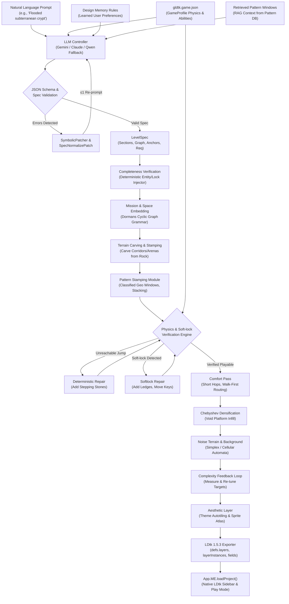
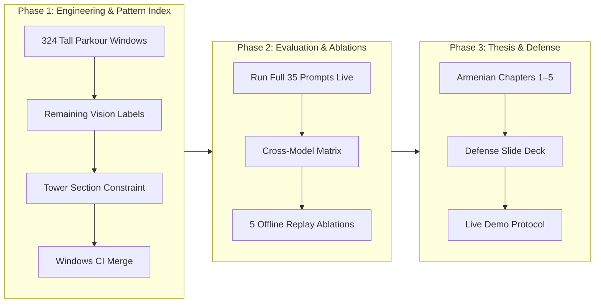

# Game World Modeling Using Machine Learning Methods
## «Խաղային աշխարհների մոդելավորում մեքենայական ուսուցման մեթոդներով»

### Comprehensive Engineering Status, Architectural Evolution, Milestone Inventory, and Master's Thesis Roadmap

---

## 1. Project Overview & Thesis Metadata

### 1.1 Academic Context & Institutional Attribution
- **Degree Program:** Master of Science in Computer Science / Software Engineering
- **Institution:** National Polytechnic University of Armenia (NPUA) / Հայաստանի ազգային պոլիտեխնիկական համալսարան (ՀԱՊՀ)
- **Department:** Computer Systems and Networks / Տեղեկատվական և հաղորդակցական տեխնոլոգիաների ու էլեկտրոնիկայի ինստիտուտ
- **Master's Candidate:** Agasi Bekiryan (Ագասի Բեկիրյան)
- **Thesis Title (English):** *Game World Modeling Using Machine Learning Methods*
- **Thesis Title (Armenian):** *«Խաղային աշխարհների մոդելավորում մեքենայական ուսուցման մեթոդներով»*
- **Primary Repository:** `bekiryan/GLDtk` (Python Neuro-Symbolic Engine, Layout Pipeline, Verification Suite)
- **Editor Integration Repository:** `bekiryan/ldtk` (Native Haxe/Electron Sidebar Panel, In-App Canvas Play Mode)
- **Target Editor:** Deepnight LDtk 1.5.3 (Level Designer Toolkit)
- **Current Baseline:** Git commit `fa0f5ce` (`HEAD -> feat/mac-release`), Pull Requests #1–#15 merged to `main`, active cross-platform packaging branches (`feat/mac-release`, `feat/windows-build`).

### 1.2 Research Relevance & Applied Significance
In modern video game production, 2D level design is notoriously time-consuming, expensive, and technically demanding. Designing high-quality platformer stages requires synthesizing macro-level narrative intent, spatial room pacing, player ability gating, hazard distribution, aesthetic theme consistency, and pixel-precise kinematic playability. 

Existing procedural content generation (PCG) methods—such as cellular automata, Wang tiling, and grammar-based rule expanders—struggle with high-level controllability and cannot comprehend natural language prompts. Conversely, naive generative artificial intelligence using large language models (LLMs) suffers from severe **spatial blindness**, generating hallucinated coordinates, impossible jump distances, broken doors with unreachable keys, and soft-lock traps.

**GLDtk (Generative Level Design Toolkit)** addresses this fundamental limitation by pioneering an end-to-end **neuro-symbolic architecture**:
1. **Neural Component (Generative Intuition):** Large Language Models (Google Gemini, Anthropic Claude, or local Ollama models such as Qwen 2.5) translate free-form textual descriptions into structured level specifications, semantic missions, section styles, and aesthetic themes.
2. **Symbolic Component (Mathematical Rigor):** Deterministic kinematic oracles, graph grammars, strongly connected component (SCC) topological solvers, and item-state reachability graphs mathematically guarantee that generated levels are 100% beatable, physically traversable, and completely free of soft-locks.
3. **Editor-Native Integration:** Unlike browser-based research prototypes or injection scripts, GLDtk is deeply embedded into the native Haxe/Electron desktop application of LDtk 1.5.3, providing game developers with an instant text-to-level workflow, interactive regional regeneration, and an in-editor playtesting engine.

### 1.3 Repository Architecture & Directory Map

```
GLDtk/
├── api/                         # FastAPI request/response data contracts
│   └── models.py                # GenerateRequest, RegionEditRequest, RouteResponse
├── server.py                    # Uvicorn/FastAPI backend host (http://127.0.0.1:8765)
├── spec/                        # Formal data schemas and level contracts
│   ├── level_spec.py            # LevelSpec, Section, Node, Edge, EntitySpec
│   └── catalog.py               # Typed entity vocabulary (Start, Exit, Enemy, Key, etc.)
├── llm/                         # LLM controller and provider abstraction layer
│   ├── prompt.py                # Cacheable system prompt & formatting rules
│   ├── validator.py             # Schema validator, SpecNormalizePatch, SymbolicPatcher
│   ├── registry.py              # Provider factory with transparent local fallback
│   └── providers/               # Concrete adapters (gemini, claude, ollama, fake)
├── symbolic/                    # Kinematic physics oracle & graph models
│   ├── schema.py                # AbstractLevelGraph (NetworkX DiGraph wrapper)
│   ├── physics.py               # Kinematic solver: ½g·t² − v·t + Δy = 0, arcs, headroom
│   ├── extractor.py             # Reconstructs AbstractLevelGraph from raw IntGrid
│   └── routes.py                # Effort-cost A* pathfinding (walk-first over jumps)
├── game/                        # Game Profile mechanics and abilities
│   └── profile.py               # GameProfile: gravity, run_speed, jump_v, wall/dash/double jump
├── pipeline/                    # Multi-stage assembly orchestrator
│   ├── level.py                 # build_level: prompt → spec → layout → verify → LDtk
│   ├── completeness.py          # Deterministic requirement verification and fill loop
│   ├── complexity.py            # Closed-loop difficulty scoring and tuning
│   ├── chunks.py                # Endless procedural chunk generation
│   ├── stamps.py                # Stamping retrieved pattern windows into sections
│   └── world.py                 # Multi-level world graph orchestration
├── layout/                      # Spatial placement, terrain carving, grid verification
│   ├── ir.py                    # IRLevel (grid[row][col], TileValue: EMPTY, SOLID, HAZARD)
│   ├── spec_layout.py           # Coordinate mapping from abstract graph to grid
│   ├── spec_entities.py         # Anti-crowding entity anchor placement
│   ├── verify.py                # Grid-level route verifier against GameProfile physics
│   ├── repair.py                # Deterministic jump stepping-stone synthesizer
│   ├── softlock.py              # SCC + item-state product graph solver
│   ├── softlock_repair.py       # Deterministic pit ledges, escape paths, key moving
│   ├── densify.py               # Chebyshev-distance void platform densification
│   ├── comfort.py               # Walk-first comfort pass (short hops, intermediate ledges)
│   ├── fill.py & noise.py       # Seeded simplex/cellular noise rock cavern fill
│   ├── terrain/                 # Procedural terrain carvers (corridor, arena, hub, shaft, labyrinth)
│   ├── ldtk_adapter.py          # Serializer targeting strict LDtk 1.5.3 JSON schema
│   └── ldtk_reader.py           # Parser reading .ldtk project files back into IRLevel
├── mission/                     # Cyclic metroidvania mission & space graph generation
│   ├── grammar.py               # Dormans-style graph rewriting rules (lock-and-key cycles)
│   ├── space.py                 # Embeds mission grammar into section terrain types
│   └── verify.py                # Solvability verification on mission-space product graph
├── patterns/                    # Pattern Library & RAG retrieval engine
│   ├── store.py                 # SQLite / FAISS vector index of pattern windows
│   ├── ingest.py                # Window slicer, route extractor, metric calculator
│   ├── classify.py              # Deterministic geometry classifier (cycles, branching, dead-ends)
│   ├── gaps.py                  # Gap window extractor for missing aspect ratios
│   ├── coverage.py              # Real-index stamping coverage measurement tool
│   ├── embed.py                 # Embedding generation (Gemini / Ollama)
│   ├── retrieve.py              # Top-k height-aware pattern retriever
│   ├── vision.py                # Multimodal visual pattern verification
│   └── sources/                 # Open-licensed corpora (SuperTux GPL-2.0, Open Surge, LDtk samples)
├── memory/                      # Cross-project design memory engine
│   ├── log.py                   # Local event logger (diffs of hand edits, undos, accepts)
│   ├── rules.py                 # LLM summary rules extractor ("prefers 2-3 enemies per room")
│   └── panel.py                 # Data provider for editor preferences
├── aesthetic/                   # Visual stylization, autotiling, and asset management
│   ├── library.py               # Manifest parser, CC0 asset librarian (Kenney, 0x72)
│   ├── autotile.py              # 256x256 bitmask autotiler for terrain sheets
│   └── image_provider.py        # AI sprite and theme generator (Gemini Flash Image)
├── eval/                        # Empirical evaluation and benchmarking harness
│   ├── prompts.json             # Benchmark suite of 35 diverse test prompts
│   ├── run.py                   # Automated benchmark runner with jittered 503 backoff
│   ├── metrics.py               # Playability %, prompt fidelity, retry rate, wall clock
│   ├── providers.py             # Benchmark provider wrappers
│   ├── recordings/              # Replayable JSON traces of LLM responses
│   └── results/                 # Evaluation output matrices and summary reports
├── packaging/                   # Standalone desktop packaging
│   ├── pyinstaller.spec         # PyInstaller spec for headless Python backend bundle
│   └── build_app.py             # Packaging orchestration for macOS DMG and Windows ZIP
└── ldtk-src/                    # Submodule / Fork of Deepnight LDtk 1.5.3 (Haxe/Electron)
    └── src/electron.renderer/ui/
        └── GldtkSidebar.hx      # Native GLDtk sidebar panel, UI controls, Play mode modal
```

---

## 2. Evolution of GLDtk: From v1 to v4

```
┌────────────────────────────────────────────────────────────────────────────────────────┐
│                                   GLDtk EVOLUTION                                      │
├────────────────────┬────────────────────┬────────────────────┬────────────────────────┤
│     v1 (Genesis)   │    v2 (Foundations)│     v3 (Realism)   │   v4 (Guarantees & RAG)│
├────────────────────┼────────────────────┼────────────────────┼────────────────────────┤
│ • Pitch & Concept  │ • LevelSpec Schema │ • Cross-Section    │ • Soft-Lock Proof via  │
│ • Sugiyama Layered │ • GameProfile      │   Gravity & Arcs   │   SCC + Item-State     │
│   Graph Layout     │ • Native LDtk Panel│ • Terrain Carving  │ • Mission Graphs       │
│ • Flat Kinematic   │ • Regional Editing │   from Rock Void   │   (Dormans Grammar)    │
│   Oracle:          │ • Entity Catalog   │ • Effort-Cost Route│ • Pattern Library RAG  │
│   ½gt² - vt + Δy=0 │ • Fidelity Reports │ • In-App Play Mode │ • Geometry Classifier  │
│ • Floating Islets  │ • AI Art Pipeline  │ • Multi-Level World│ • Design Memory        │
│   in Empty Void    │ • M1–M4 Reviews    │ • Packaged Mac App │ • Closed-Loop Complex. │
└────────────────────┴────────────────────┴────────────────────┴────────────────────────┘
```

### 2.1 The Genesis (v1): The "AI Trap", Sugiyama Layout, and the Elementary Physics Oracle
The original vision of GLDtk, outlined in `Generative-Level-Design-Toolkit.pdf`, targeted the fatal flaw of contemporary generative AI in video games: **the "AI Trap"**. Pure neural models generate levels that appear creative on surface inspection but are physically unplayable—riddled with hallucinated geometry, impossible jump distances, and floating islands with no traversal routes.

In v1, the architecture attempted to bridge this gap through a two-stage pipeline:
1. **Abstract Graph Generation:** An LLM was prompted to emit an abstract directed graph $G = (V, E)$, where $V$ represented platforms and $E$ represented jump/walk transitions.
2. **Sugiyama Layout Engine:** The abstract graph was laid out on a 2D grid using the classic four-phase Sugiyama algorithmic framework:
   - Cycle removal via feedback arc set heuristics.
   - Layer assignment (ranking nodes into discrete vertical or horizontal layers).
   - Vertex ordering to minimize edge crossings.
   - Coordinate assignment assigning platforms to discrete grid coordinates.
3. **Basic Kinematic Oracle:** Every jump edge between platform $(x_1, y_1)$ and $(x_2, y_2)$ was validated using elementary kinematics:
   $$\Delta x = v_x \cdot t, \quad \Delta y = v_y \cdot t - \frac{1}{2} g t^2$$
   Solving for real time $t > 0$ under discriminant $D = v_y^2 - 2g \Delta y \ge 0$.

#### Why v1 Was Insufficient for Production
While v1 demonstrated the viability of neuro-symbolic validation, it had significant practical shortcomings:
- **Floating Platform Syndrome:** Levels resembled disjointed floating rectangles in an empty void. There were no natural walls, ceilings, caves, or enclosed architectural spaces.
- **Physics Disconnect:** The physics oracle assumed universal, constant gravity, single-point hitbox physics, and infinite vertical headroom. It had no concept of low ceilings, player crouching, or advanced platformer mechanics (wall jumps, dashes, double jumps).
- **Editor Isolation:** Early experiments relied on fragile browser overlays or external file watchers rather than deep integration with an industry-standard editor.
- **Brittleness:** An invalid edge emitted by the LLM caused the layout to fail completely, with no automated self-healing or repair mechanism.

### 2.2 Transition to v2: Native Editor Integration, `GameProfile`, Prompt Fidelity & Regional Editing
Conceived in the comprehensive design review on 2026-10-13 (`docs/v2/DESIGN.md`), GLDtk v2 restructured the entire foundation into a robust, production-grade system:
- **Structured Schema (`LevelSpec`):** Replaced unstructured `{nodes, edges}` prompts with strict JSON-schema-enforced output across Gemini Flash, Claude 3.5, and Ollama. The specification formalizes level dimensions, named macro-sections, topological connections, typed entity anchors, and explicit player requirements.
- **The `GameProfile` Model:** Decoupled player physics from level geometry. Stored alongside the project in `gldtk.game.json`, it defines horizontal run speeds, jump velocities, gravity, and unlocked abilities (double jump, air dash, wall jump). The physics oracle was rewritten to evaluate reachability using the player's active abilities.
- **Native LDtk Haxe Integration:** Rebuilt as a first-class sidebar panel (`GldtkSidebar.hx`) compiled directly into LDtk's Electron renderer via Haxe. Designers interact with GLDtk within their everyday level editor without leaving the application.
- **Fidelity & Completeness Loop:** Built a deterministic post-processor that inspects the generated level against every constraint extracted from the prompt. If the LLM omitted a requested item (e.g. "a hidden sword behind a waterfall"), a deterministic completeness pass automatically instantiates and anchors the entity without triggering expensive LLM re-prompting.
- **Regional Editing with Seam Locks:** Introduced localized regenerations. Designers can drag a selection box or select a section in the sidebar to re-generate only that region. GLDtk locks boundary entry/exit seams, recalculates internal geometry, repairs jump trajectories, and records snapshots in an undo stack (`↶ Undo last GLDtk edit`).
- **Entity Catalog & Autotiling:** Integrated Kenney and 0x72 CC0 sprite sheets into a native asset pipeline (`gldtk_assets/`), supporting typed entities (Start, Exit, Enemy, Pickup, Weapon, Interactive, Checkpoint, Key) with LDtk custom `fieldDefs`.

### 2.3 Transition to v3: Physical Realism, Comfort Hops, Terrain Carving, In-App Play Mode & Worlds
Requested after milestone M4 on 2026-10-15 (`docs/v3/PLAN.md`), v3 tackled gameplay feel, spatial aesthetics, and editor interactivity:
- **Physics Accuracy:** Upgraded the kinematic oracle to handle heterogeneous gravity fields across sections (`gravity_scale`), exact multi-surface wall-jump parabolas, and strict ceiling clearance checks (`headroom`).
- **Terrain Carving (Moving Away from Floating Platforms):** At the user's explicit request, levels were transformed from floating stepping stones into solid rock masses carved by specialized procedural terrain generators (`layout/terrain/`). Sections gained architectural structure types: **corridor**, **arena**, **shaft**, **hub**, and **labyrinth**.
- **Short Hops & Walk-First Paths:** Pathfinding was overhauled to prioritize player comfort. A* pathfinding adopted effort-cost routing, heavily penalizing unnecessary jumping. The comfort pass (`layout/comfort.py`) automatically synthesizes intermediate stepping stones for climbs exceeding comfort thresholds.
- **Interactive Route Overlay:** Added visual debug routes directly onto LDtk's canvas, rendering verified golden paths in green, high-effort jumps in amber, and disconnected platforms in red.
- **In-App Play Mode Modal:** Embedded a native HTML5 canvas platformer controller directly inside LDtk, allowing designers to hit Play and instantly test mechanics using the active `GameProfile` physics, collecting keys, battling enemies, and reaching the exit.
- **Multi-Level Worlds:** Expanded GLDtk to generate multi-room dungeon complexes linked via entity references and linear world layouts.
- **Packaged Standalone Mac App:** Packaged the entire suite (Python server bundled via PyInstaller, Electron app compiled with Haxe) into a self-contained `.dmg` installer.

### 2.4 Transition to v4: Deterministic Solvability, Dormans-Style Mission Graphs, RAG Pattern Stamping, and Design Memory
Initiated on 2026-10-15 (`docs/v4/PLAN.md`), v4 elevated GLDtk from an intelligent level generator into an advanced, mathematically guaranteed game-world synthesis engine:
- **Soft-Lock Elimination Guarantee:** Upgraded the verification guarantee from *"Start reaches Exit"* to *"The player can never become permanently trapped"*. Implemented Strongly Connected Component (SCC) analysis over the movement graph combined with an **Item-State Product Graph** ($G' = V \times S$), catching one-way drop traps and key-door sequencing errors. Built deterministic auto-repairs to place escape ledges or move keys before fatal drops.
- **Mission & Space Graphs (Dormans Grammar):** Integrated Joris Dormans-style generative graph grammars (`mission/`). The LLM selects narrative rules (e.g. lock-and-key cycles, ability-gated areas, shortcut loops), the grammar rewrites the abstract topology safely, and the space embedding module maps the mission into section terrain types.
- **Closed-Loop Level Complexity Target:** Introduced a unified `complexity` metric (1–10). A closed-loop feedback monitor measures jump tightness, hazard density, dead-end depth, and enemy frequency post-generation, deterministically tuning parameters to hit the target.
- **Seeded Noise Terrain & Endless Chunks:** Added Minecraft-style multi-octave simplex/Perlin noise with cellular automata smoothing to fill cavern walls and backgrounds, while strictly preserving clearance around the golden path jump arcs. Enabled infinite side-scrolling level chunks via seam-matching border hashes (`POST /chunks`).
- **Pattern Library & RAG Retrieval:** Ingested real, open-licensed platformer stages (SuperTux GPL-2.0, Open Surge, LDtk sample projects). Cut levels into semantic windows, indexed their movement graphs in SQLite/vector storage, and implemented Retrieval-Augmented Generation (RAG) to inject real-world level design snippets into the LLM prompt.
- **Pattern Stamping & Geometry Classification:** Allowed the engine to directly stamp retrieved pattern windows into section grids. Solved aspect ratio mismatches by building a deterministic geometry classifier (`classify.py`) that analyzes cycle ranks and dead ends, and implemented height stacking and rock padding.
- **Cross-Project Design Memory:** Created a local learning subsystem in `Application Support/GLDtk/memory/` that logs user hand edits, tile modifications, and undos across projects, distilling preferences into concise LLM prompt rules (e.g., *"designer prefers 3-tile gaps and low hazard density"*).
- **Multimodal Vision Verification:** Integrated visual pattern labeling (`patterns/vision.py`) using vision models (Gemini 3.5 Flash Lite, Qwen 2.5-VL) to render PNGs of pattern windows and verify textual claims against actual grid counts.

### 2.5 High-Level Pipeline Architecture Diagram & Dataflow



---

## 3. Complete Inventory of Completed Work

### 3.1 Table of v2 Parts (Parts 1–10 + Reviews & Fixes)

| # | Part / Milestone | Repository | Complexity | Summary & Key Deliverables | Status | Key Commits / PR |
|---|---|---|---|---|---|---|
| **1** | Level Spec Schema & Structured Providers | Python | High | Defined `LevelSpec`, `Section`, `Node`, `Edge`, `EntitySpec`. Built structured output schemas for Gemini, Claude, Ollama; added `FakeProvider` for hermetic offline testing. | ✅ Done | `feat/v2` (PR #1) |
| **2** | Game Profile & Ability-Aware Physics | Python | High | Introduced `gldtk.game.json` (`GameProfile`). Rewrote physics oracle for double jumps (chained parabolas), air dash (horizontal offset), wall jumps, and per-section `gravity_scale`. | ✅ Done | `feat/v2` (PR #1) |
| **3** | Layout v2 & Grid Physics Verification | Python | High | Sized sections according to prompt specifications; placed semantic anchors. Re-verified kinematics on the final tile grid (`symbolic/extractor.py`) with deterministic stepping-stone repair. | ✅ Done | `feat/v2` (PR #1) |
| **4** | Entity Catalog & Full LDtk Export | Python | Medium | Formalized entity kinds (Player/Start, Exit, Enemy, Pickup, Weapon, Interactive, Checkpoint, Key) with typed LDtk `fieldDefs` and custom level fields. Validated against LDtk JSON schema. | ✅ Done | `feat/v2` (PR #1) |
| **M1** | User Review: End-to-End Baseline | Both | — | Evaluated full prompt-to-level generation in LDtk. Uncovered layer-ordering visual bleed, load-modified dirty flags, entity piling, and untextured entities. | ✅ Done | Milestone Review |
| **7** | Fidelity Report & Completeness Loop | Python | High | Implemented prompt requirement extraction, deterministic verification (`satisfied`, `approximated`, `impossible`), and the automatic completeness fill loop. | ✅ Done | `feat/v2` (PR #1) |
| **7b** | M1 Fixes (Export, Layout, Art) | Python | Medium | Fixed layer ordering (Entities, Tiles, Collisions); eliminated entity crowding via platform widening/relocation; packed CC0 sprite atlas into `gldtk_assets/sprites.png` for entity icons. | ✅ Done | `feat/v2` (PR #1) |
| **9** | Native Haxe Sidebar UI | Haxe | Medium | Developed `GldtkSidebar.hx` in LDtk Electron renderer using raw `XMLHttpRequest`. Provided prompt input, status displays, fidelity report trees, and provider pickers. | ✅ Done | `bekiryan/ldtk` (PR #1) |
| **M2** | User Review: In-Editor Integration | Both | — | Live validation inside LDtk. Identified file-watcher reload race conditions, stale layer renders during level swap, and platform density issues. | ✅ Done | Milestone Review |
| **9b** | M2 Fixes (Python + Haxe) | Both | Strong | **Python:** Added Chebyshev densification pass, vertical section support, hazard spacing. **Haxe:** Suppressed false modified flags on tileset reloads, flushed stale `WorldRender` caches. | ✅ Done | `feat/v2` (PR #1) |
| **5** | Curated Asset Library | Python | Low | Built data-driven asset catalog (`assets/manifest.json`) using CC0 Kenney and 0x72 pixel art; implemented 256x256 bitmask autotiler. | ✅ Done | `feat/v2` (PR #1) |
| **8** | Regional Editing & Undo History | Both | High | **Backend (8a):** Boundary seam locking, localized graph extraction, partial re-layout, snapshot history. **Sidebar (8b):** Bounding-box selection, section dropdowns, "Undo last edit" button. | ✅ Done | `feat/v2` (PR #1) |
| **M3** | User Review: Interactive Editing | Both | — | Validated regional regeneration modes, rectangle selections, and seam integrity under live Gemini execution. | ✅ Done | Milestone Review |
| **10** | Empirical Evaluation Harness | Python | Low | Created test suite in `eval/` with 35 structured prompts, automated metrics collection (playability %, fidelity %, wall-clock latency, repair frequencies). | ✅ Done | `feat/v2` (PR #1) |
| **6** | AI Theme & Sprite Generation | Python | Medium | Implemented pluggable generative image interface (`aesthetic/image_provider.py`) targeting Gemini Flash Image with downscaling to 16px, palette quantization, and seam checking. | ✅ Done | `feat/v2` (PR #1) |
| **M4** | Final v2 Review & Integration | Both | — | Completed final polish, merged PR #1 in `bekiryan/GLDtk` and PR #1 in `bekiryan/ldtk`. Formulated the v3 enhancement roadmap. | ✅ Done | PR #1 Merged |

---

### 3.2 Table of v3 Parts (Parts 11–21)

| # | Part Name | Repository | Wave | Summary & Key Deliverables | Status | Impact / Measured Metric |
|---|---|---|---|---|---|---|
| **11** | Physics Accuracy | Python | Wave 1 | Handled cross-section gravity boundaries via numerical piecewise arc integration; added ceiling clearance checks (`headroom`) and exact wall-jump arcs. | ✅ Done | Eliminated false verifier passes under low ceilings; eval replay 8/8 at 1.00 fidelity. |
| **12** | Densify Inside Edits | Python | Wave 1 | Extended Chebyshev platform densification to localized regional edits with locked boundaries; strictly preserved seed determinism. | ✅ Done | Output byte-identical across identical seeds; eliminated empty voids in regional edits. |
| **13** | Route Overlay | Both | Wave 1 | Computed player traversal routes via `GET /route`. Painted color-coded trajectories directly onto LDtk canvas (golden paths, hops, disconnected nodes). | ✅ Done | Instant visual feedback in editor; updates dynamically following hand edits. |
| **14** | Live Progress & Cancel | Both | Wave 2 | Built server job tracking (`POST /generate/async`, `GET /jobs/{id}`) with retry progress messages; added UI Cancel button aborting backoff sleeps safely. | ✅ Done | Safe cancellation without writing corrupted partial project files to disk. |
| **15** | Difficulty Curve | Both | Wave 3 | Analyzed jump tightness, hazard density, and traversal effort per section; added difficulty line chart in sidebar highlighting section bands on hover. | ✅ Done | Quantitative difficulty visualization; real-time updates on manual tile edits. |
| **16** | Native In-App Play Mode | Haxe | Wave 4 | Built modal HTML5 canvas platformer in LDtk renderer simulating `GameProfile` kinematics (within 1 px of verifier), ghost routes, pickups, health, checkpoints, exit. | ✅ Done | Instant in-editor playtesting without compiling external game engines. |
| **17** | Multi-Level Worlds | Both | Wave 5 | Implemented world outline generator creating interconnected LDtk level complexes. Handled linear/grid layouts and entity transitions with null-guarded swaps. | ✅ Done | Multi-room dungeon generation with inter-level level linking. |
| **20** | Short Hops & Walk-First Paths | Python | Wave 4 | Introduced effort-cost A* routing favoring walking over jumping. Comfort pass (`layout/comfort.py`) added intermediate stepping stones for climbs. | ✅ Done | Jump distances reduced from 10–15 tiles to comfortable 3–4 tile hops. |
| **21** | Terrain Carving from Rock | Both | Wave 5 | Replaced empty canvas generation by carving rooms out of solid rock. Supported structure types: corridor, arena, shaft, hub, labyrinth, and open. | ✅ Done | Transformed visual quality to match production metroidvanias (Spelunky, Blasphemous). |
| **18** | Packaged Standalone Mac App | Both | Last | Bundled Python backend with PyInstaller; created unsigned Apple Silicon `.dmg` (322 MB app / 144 MB DMG) with lifecycle management. | ✅ Done | Zero-terminal desktop installation for macOS users. |
| **19** | Armenian Documentation | Docs | Last | Translated full product documentation, architecture overviews, and user guides into Armenian (`README.hy.md`). | ✅ Done | Institutional compliance with NPUA thesis requirements. |

---

### 3.3 Table of v4 Parts (Parts 22–29g)

| # | Part Name | Scope | Summary & Key Deliverables | Status |
|---|---|---|---|---|
| **22** | Soft-Lock Elimination Engine | Python | Implemented Tarjan's SCC on the directed movement graph and an Item-State Product Graph ($G' = V \times S$). Deterministic auto-repairs place escape ledges and move trapped keys. | ✅ Done |
| **23** | Mission & Space Graph Generation | Python | Implemented Dormans-style graph rewriting grammar (`mission/grammar.py`) for lock-key cycles, ability gates, and shortcuts. Embedded grammar into physical terrain types. | ✅ Done |
| **24** | Closed-Loop Complexity Target | Python | Unified level difficulty into a single 1–10 slider. Monitored post-generation metrics and closed the loop by deterministically adjusting gap widths and enemy counts. | ✅ Done |
| **25** | Noise Terrain Fill & Endless Chunks | Python | Added seeded simplex/Perlin noise with cellular automata smoothing to fill caverns while preserving jump clearance. Built `POST /chunks` with fixed-seam border hashes. | ✅ Done |
| **26a** | Pattern Library & Vector RAG | Python | Ingested open platformer level corpora into SQLite/vector index (`patterns/store.py`). Extracted movement routes, metrics, and few-shot ASCII examples for LLM context. | ✅ Done |
| **26b** | Pattern Stamping into Sections | Python | Implemented direct stamping of retrieved pattern windows into carved section grids (`pipeline/stamps.py`), adapting dimensions and falling back to procedural generators on failure. | ✅ Done |
| **26c** | Kept Levels Ingestion | Python | Added auto-ingestion of user-approved levels into the local pattern library, continually expanding the studio's retrieved design patterns. | ✅ Done |
| **26d** | Open Level Corpora Integration | Python | Integrated SuperTux (GPL-2.0) and Open Surge open corpora with formal licensing metadata, attribution headers, and geometric feature extraction. | ✅ Done |
| **26e** | Pattern Library Rebuild & Deduplication | Python | Re-indexed pattern windows with SuperTux scale-1 normalization, deduplication heuristics, and quality filters. | ✅ Done |
| **26f** | Deterministic Geometry Classifier | Python | Implemented `patterns/classify.py` to identify topological features (cycle rank $E-V+C$, branching factor, dead ends, room size) into labyrinth, arena, hub, and shaft categories. | ✅ Done |
| **27a** | Design Memory Backend | Python | Created per-user event logger (`memory/log.py`) recording hand-edit diffs, undos, and prompt patterns in `Application Support/GLDtk/memory/`, distilling them into summary rules. | ✅ Done |
| **27b** | Design Memory Sidebar Panel | Haxe | Built native LDtk panel displaying learned designer rules with interactive editing, toggling, and reset capabilities. | ✅ Done |
| **28** | Tight Physics & Comfort Defaults | Python | Established production-grade default physics ($g=1800, v_j=500, v_x=220$), capping max jump height at 4.3 tiles and width at 7.6 tiles, eliminating floatiness. | ✅ Done |
| **29a** | Stamping Sidebar Controls | Haxe | Added "Use real level pieces" checkbox in the LDtk sidebar with real-time attribution display for stamped patterns in generation results. | ✅ Done |
| **29b** | Play Mode Soft-Lock Visualizer | Haxe | Highlighted soft-lock spans with faint red bands in Play mode; added non-fatal warning toasts when the player's hitbox enters an unescapable trap. | ✅ Done |
| **29c** | Decorative Background Layer | Python | Added non-colliding `Background` IntGrid layer populated with seeded noise cavern silhouettes below gameplay layers, strictly preserving layer ordering rules. | ✅ Done |
| **29d** | Vision Labeling of Patterns | Python | Developed `patterns/vision.py` to render pattern PNGs and employ multimodal vision models (Gemini 3.5 Flash Lite, Qwen 2.5-VL) with anti-hallucination fact checking. | ✅ Done |
| **29g** | Library Gap Filling & Coverage Tool | Python | Developed `patterns/coverage.py` and `patterns/gaps.py`. Extracted 641 specialized gap windows, implemented height-aware candidate matching, and achieved 4/4 stamp coverage. | ✅ Done |

---

### 3.4 Delivery Inventory: Pull Requests #1–#15 & Packaging/CI Pipelines

| PR # | Branch Name | Title / Purpose | Key Contributions & Architectural Changes | Merge Date |
|---|---|---|---|---|
| **#1** | `feat/v2` | GLDtk v2: Full prompt fidelity, Game Profile, regional editing | Delivered foundational v2 architecture: `LevelSpec`, `GameProfile`, layout engine, entity catalog, completeness loop, and LDtk Haxe integration. | 2026-10-15 |
| **#2** | `feat/v2` | GLDtk v3–v4 completion: Pattern library, stamping, tighter physics | Merged major v3 and v4 modules: noise terrain, Dormans mission graphs, RAG pattern library, closed-loop complexity, tight physics, and design memory. | 2026-10-17 |
| **#3** | `feat/demo-video` | Automated manual vs. GLDtk benchmark video recorder | Added Playwright automation scripts recording side-by-side level authoring (Manual 5:57 / 311 steps vs. GLDtk 1:13 / 172 steps). | 2026-10-18 |
| **#4** | `fix/plain-level-steps` | Walkable 1-tile steps on plain LDtk levels | Fixed false soft-lock reports on native plain LDtk levels lacking `gldtk_sections` metadata under low ceilings. | 2026-10-19 |
| **#5** | `fix/verifier-arcs` | Verification gap documentation update | Confirmed and documented that Part 3 verifier edge cases were completely resolved by Part 11's piecewise arc integration. | 2026-10-19 |
| **#6** | `fix/eval-backoff` | Jittered exponential backoff & fallback tracking | Implemented 20s/60s/120s backoff for Gemini HTTP 503 errors and recorded `answered_by` metadata across evaluation runs. | 2026-10-19 |
| **#7** | `fix/qwen-specs` | Local model schema normalization & partial patches | Added `SpecNormalizePatch` and `EdgeReclassifyPatch` to handle Qwen2.5 schema drift; rescued local model evaluation replay from 0/6 to 5/6 success. | 2026-10-19 |
| **#8** | `fix/section-fidelity` | Prompt structure fidelity & lock-key repair | Enforced prompt-specified structures (`P_<type>`) in completeness loop; gracefully fell back to procedural structures if retyping broke verification. | 2026-10-19 |
| **#9** | `feat/29d-vision` | Multimodal vision labeling for pattern library | Added `patterns/vision.py` with automated negation-aware fact checking, verifying 917 patterns with Gemini 3.5 Flash Lite / Qwen 2.5-VL. | 2026-10-19 |
| **#10** | `feat/library-gaps` | Pattern library gap windows & height-aware finder | Added 641 specialized gap windows (`patterns/gaps.py`) and height-aware candidate scoring in `StampFinder`. | 2026-10-20 |
| **#11** | `fix/stamp-gaps` | Traversal check on stamped windows & rock padding | Filtered out stamped windows failing `level_route`; padded narrow windows with rock instead of distorting horizontal aspect ratios. | 2026-10-20 |
| **#12** | `docs/status-2026-10-20` | Project documentation & status synchronization | Updated engineering progress docs, recorded live evaluation outcomes, and documented new CLI operational flags. | 2026-10-20 |
| **#13** | `fix/no-key-warning` | User-friendly missing API key warning | Clarified fallback notification to state *"no Gemini API key configured"* instead of misleading connection error toasts. | 2026-10-20 |
| **#14** | `feat/provider-keys` | Per-provider API key storage in `/settings` | Added multi-provider key management API and UI fields in LDtk settings modal, storing credentials in user application support directories. | 2026-10-20 |
| **#15** | `fix/samples-readonly` | Write protection for bundled sample files | Enforced strict write guard preventing accidental modification or corruption of LDtk's default bundled sample levels. | 2026-10-20 |

#### Packaging & CI/CD Pipelines
- **macOS Release Workflow (`feat/mac-release`):**
  - Configured GitHub Actions workflow (`.github/workflows/release.yml`) triggered on version tags (`v*`) and manual dispatch.
  - Builds the headless Python server using PyInstaller (`packaging/pyinstaller.spec`), bundles Electron renderer assets compiled via Haxe, and generates an unsigned Apple Silicon `.dmg` (322 MB uncompressed, 144 MB disk image).
- **Windows Packaging Workflow (`feat/windows-build`):**
  - Solved Windows console encoding crashes by enforcing UTF-8 standard output (`sys.stdout.reconfigure(encoding='utf-8')`).
  - Implemented headless Windows executable bundling (`server.exe`) and Electron packaging.
  - Integrated backend smoke-tests directly into CI, launching the bundled binary and verifying `/health` and generation endpoints.

---

## 4. 10 Major Engineering Problems Encountered & How They Were Solved

```
┌────────────────────────────────────────────────────────────────────────────────────────┐
│                      10 MAJOR ENGINEERING PROBLEMS & SOLUTIONS                         │
├────┬─────────────────────────────┬─────────────────────────────────────────────────────┤
│ 1  │ Floating Platforms Syndrome │ Inverted procedural terrain carving from solid rock │
│ 2  │ LLM Spatial Blindness       │ Semantic anchors, section bounds & topological ports│
│ 3  │ Floaty Physics & Jump Spam  │ Effort-cost A* routing & tight kinematic baseline   │
│ 4  │ Low Ceilings & Gravity Jumps│ Piecewise numerical integration & headroom check    │
│ 5  │ Soft-Locks & Item Traps     │ Tarjan SCC + Item-State Product Graph solver        │
│ 6  │ Sparse Canvases             │ Chebyshev-distance void platform densification      │
│ 7  │ Gemini 429/503 Outages      │ Jittered backoff + transparent Ollama Qwen fallback │
│ 8  │ Qwen Schema Drift           │ SpecNormalizePatch & incremental partial patching   │
│ 9  │ LDtk False Modified Flag    │ Strict layer order, cached fields & render flushing │
│ 10 │ Stamp Height/Aspect Gaps    │ Geometry classifier, rock padding & stair stacking  │
└────┴─────────────────────────────┴─────────────────────────────────────────────────────┘
```

### Problem 1: Floating Platforms Syndrome $\to$ Procedural Terrain Carving from Solid Rock
- **Context & Symptom:** In v1 and early v2, generated levels consisted of isolated rectangular platforms suspended in an empty void (`EMPTY = 0`). The resulting levels felt unnatural, lacked physical weight, and bore little resemblance to commercial platformers like *Blasphemous*, *Spelunky*, or *Hollow Knight*.
- **Root Cause Analysis:** The layout pipeline treated space additively: starting from an empty grid, it placed platforms only where the abstract graph nodes dictated. Surrounding cells were left unfilled, creating disjointed floating islands.
- **Solution & Implementation:** In Part 21 (`layout/terrain/`), the generative paradigm was inverted. The bounding canvas is initialized completely as **solid rock** (`SOLID = 1`). Specialized procedural terrain generators carve negative air space according to macro-structural types:
  - `corridor`: Horizontal tunnels with wavy floors, ceiling stalactites, and low clearance.
  - `arena`: Expansive enclosed chambers with flat combat floors, high ceilings, and stepped side observation perches.
  - `shaft`: Vertical chambers with staggered wall ledges, requiring alternating wall-kicks or tight upward climbing arcs.
  - `hub`: Central nexus rooms featuring at least three arterial connection ports along boundaries.
  - `labyrinth`: Winding maze-like paths with cycle ranks $E - V + C \ge 2$, dead-end detours, and branching spans.
  Boundary ports between adjacent sections are deterministically aligned, ensuring that carved spaces connect seamlessly without manual alignment.

### Problem 2: LLM Spatial Blindness $\to$ Semantic Anchors & Boundary Ports
- **Context & Symptom:** When prompted to output raw $(x, y)$ coordinate positions for platforms and entities, LLMs consistently hallucinated: placing platforms out of bounds, overlapping solid blocks, creating jumps that spanned 40 tiles, or placing doors inside walls.
- **Root Cause Analysis:** Autoregressive language models lack spatial-coordinate reasoning. Tokenizing numbers prevents neural architectures from calculating Euclidean distances or verifying bounding box overlaps during generation.
- **Solution & Implementation:** Developed the `AbstractLevelGraph` schema in `spec/level_spec.py`. The LLM is restricted to defining topological relationships and semantic positions:
  - Nodes specify semantic roles (`START`, `EXIT`, `PLATFORM`, `HAZARD`).
  - Edges define high-level intent (`WALK`, `JUMP`, `FALL`) without exact distances.
  - Sections define relative spatial arrangements (e.g. `order: 0`, `theme: "dungeon"`, `structure: "labyrinth"`).
  The spatial layout engine (`layout/spec_layout.py`) resolves these abstract topological relationships into concrete grid coordinates via layered graph drawing, section partitioning, and semantic anchor binding. Entities are anchored to platform nodes rather than arbitrary coordinate points.

### Problem 3: Floaty Physics & Jump Spam $\to$ Effort-Cost Routing & Tight Physics Baseline
- **Context & Symptom:** Playtesters reported that traversal felt ungrounded and floaty. The pathfinder produced routes consisting almost entirely of continuous maximum-height jumps across platforms, ignoring walkable floor spans.
- **Root Cause Analysis:** Early physics defaults allowed unrealistic jump trajectories (up to 12 tiles high and 20 tiles wide). Furthermore, standard Dijkstra pathfinding treated walk transitions and maximum-effort jump transitions as having identical edge weights.
- **Solution & Implementation:**
  1. **Effort-Cost Routing (`symbolic/routes.py`):** Overhauled pathfinding edge costs. Walking carries a baseline cost of $1.0$ per tile. Jumps incur an exponential effort penalty:
     $$\text{Cost}_{\text{jump}} = 2.5 + 1.2 \cdot \Delta y_{\text{rise}} + 0.5 \cdot \Delta x$$
     This forces the pathfinder to favor walking and short hops whenever available.
  2. **Tight Physics Baseline (Part 28):** Standardized default platformer kinematics in `game/profile.py`:
     $$\text{Gravity } g = 1800 \text{ px/s}^2, \quad \text{Jump Velocity } v_j = 500 \text{ px/s}, \quad \text{Run Speed } v_x = 220 \text{ px/s}$$
     At a standard $16 \times 16$ tile resolution, this caps the maximum jump height at $\approx 4.3$ tiles and horizontal reach at $\approx 7.6$ tiles, producing responsive, punchy platforming mechanics.
  3. **Comfort Pass (`layout/comfort.py`):** Evaluates all climbs exceeding $3$ vertical tiles or $4$ horizontal tiles, automatically injecting intermediate stepping platforms to prevent exhausting maximum-effort jumps.

### Problem 4: Low Ceilings & Gravity Transitions $\to$ Piecewise Numerical Integration & Headroom Splitting
- **Context & Symptom:** Jump trajectories verified as mathematically valid by the symbolic oracle frequently failed during actual gameplay. Players struck their heads on low ceiling overhangs, truncating their upward momentum and plunging into pits. Furthermore, jumps transitioning across section boundaries with differing gravity scales broke down completely.
- **Root Cause Analysis:** The closed-form quadratic jump equation:
  $$\frac{1}{2} g t^2 - v_y t + \Delta y = 0$$
  assumes constant, homogeneous gravity throughout the trajectory and infinite vertical clearance. It cannot account for ceiling collisions or spatially varying gravity fields.
- **Solution & Implementation:** Implemented numerical piecewise arc integration in Part 11 (`symbolic/physics.py`):
  1. Trajectories are numerically integrated using discrete time steps ($\Delta t = 0.016\text{s}$):
     $$y(t + \Delta t) = y(t) + v_y(t) \cdot \Delta t, \quad v_y(t + \Delta t) = v_y(t) - g(\text{section}) \cdot \Delta t$$
  2. At each integration step, the player hitbox ($14 \times 14\text{ px}$) is checked against the solid collision grid.
  3. If a ceiling collision is detected before the trajectory apex ($v_y > 0$), upward vertical velocity is instantly clamped to $0$ (head bonk), and the downward fall arc is simulated from that point.
  4. Exact multi-surface wall-kick parabolas are integrated separately, validating rebound velocity and wall contact clearance.

### Problem 5: Soft-Locks & Item Sequencing Traps $\to$ Tarjan SCC & Item-State Product Graph
- **Context & Symptom:** While levels guaranteed that a valid path existed from Start to Exit, players could easily become permanently trapped (soft-locked). Falling into a pit with no climbable walls, dropping past a one-way ledge, or passing through a one-way door before collecting its key rendered the stage impossible to complete.
- **Root Cause Analysis:** Single-source reachability algorithms (such as BFS or Dijkstra from Start) only verify that an exit path exists from the initial spawn point. They do not ensure that every reachable intermediate state maintains an exit path.
- **Solution & Implementation:** Developed the soft-lock verification and repair engine in Part 22 (`layout/softlock.py` and `softlock_repair.py`):
  1. **Strongly Connected Components (SCC):** Evaluated over the directed movement graph using Tarjan’s algorithm. Any component reachable from Start that lacks a directed path to an Exit component is flagged as a catastrophic soft-lock.
  2. **Item-State Product Graph ($G' = V \times S$):** Modeled state as $(v, s)$, where $v$ is a walkable span and $s \subseteq \{\text{Key}_1, \text{Key}_2, \dots, \text{Ability}_k\}$ represents acquired items. An edge exists from $(u, s) \to (v, s')$ if traversal is physically valid and collecting an item transitions $s \to s'$. The exit state must be reachable from all reachable $(v, s)$ states.
  3. **Deterministic Softlock Repair:** Automatically identifies failure points and synthesizes fixes: adding a climbable stepping ledge out of a pit, inserting a one-way escape vent, or relocating a key upstream before a one-way drop.

### Problem 6: Sparse Canvases & Visual Emptiness $\to$ Chebyshev-Constrained Densification
- **Context & Symptom:** After laying out the LLM's specified platforms along the critical path, expansive areas of the grid remained completely barren, resulting in uninteresting open dead spaces.
- **Root Cause Analysis:** LLM context constraints limit generation to macro-level platforms (typically 6–12 platforms per level). The model cannot specify dozens of ambient background ledges without exceeding token limits and degrading reasoning quality.
- **Solution & Implementation:** Built the Chebyshev densification pass in Part 12 and M2 fixes (`layout/densify.py`):
  1. Scans empty void regions using Chebyshev distance metrics:
     $$D_\infty(p_1, p_2) = \max(|x_1 - x_2|, |y_1 - y_2|)$$
  2. Targets a balanced platform density of approximately 1 platform per 40–60 empty cells.
  3. Generates decorative and intermediate stepping platforms (3–8 tiles wide) in open pockets.
  4. **Strict Traversal Invariant:** Synthesized platforms are tested against all existing jump parabolas along the golden path. If an added platform obstructs a jump arc or introduces a soft-lock, it is discarded immediately.

### Problem 7: API Rate Limits & Transient Outages (Gemini 429/503) $\to$ Exponential Backoff & Local Ollama Fallback
- **Context & Symptom:** Live evaluations and automated test runs frequently failed when relying on the Gemini Flash free tier, which imposes strict quotas (~20 requests/day per model) and suffers from intermittent HTTP 503 "High Demand" service errors.
- **Root Cause Analysis:** External cloud LLM APIs are inherently nondeterministic in availability and latency. Long pipeline runs abort if any single call experiences a rate limit or transient network failure.
- **Solution & Implementation:** Engineered a resilient fallback provider layer in `llm/registry.py` and PR #6:
  1. **Jittered Exponential Backoff:** On HTTP 503 / `UNAVAILABLE` errors, the system automatically pauses and retries after $20\text{s}$, $60\text{s}$, and $120\text{s}$ before failing.
  2. **Transparent Local Model Fallback:** If cloud retries fail or an HTTP 429 quota exhaustion is detected, the server automatically routes the request to a local Ollama instance (`ollama:qwen2.5:14b`) with a 900-second timeout.
  3. **State Resumption:** Fallback metadata is logged in `answered_by`, and subsequent requests immediately re-attempt the primary cloud model before falling back, preventing permanent provider lock-in.

### Problem 8: Local Model Schema Drift (Qwen 2.5) $\to$ `SpecNormalizePatch` & Partial Re-Prompting
- **Context & Symptom:** While Qwen 2.5-14b runs reliably offline, its raw structured JSON output frequently suffered from schema drift: emitting out-of-bounds node indices, hallucinated entity references, unnormalized complexity values ($> 1.0$), or placing entities directly on hazard spikes.
- **Root Cause Analysis:** Smaller open-weight models have weaker instruction-following fidelity than large commercial models, occasionally violating edge constraints in complex JSON schemas.
- **Solution & Implementation:** Developed robust schema repair patches in PR #7 (`llm/validator.py`):
  1. `SpecNormalizePatch`: Automatically clamps out-of-bounds platform coordinates, rescales out-of-range complexity metrics, strips dangling entity references, and shifts entities off hazard tiles to safe neighboring platforms.
  2. `EdgeReclassifyPatch`: Evaluates all `WALK` edges; if the vertical elevation between connected platforms exceeds walking limits, the edge is automatically converted to a `JUMP` transition.
  3. **Incremental Partial Re-prompting:** The controller retains valid subgraphs and re-prompts the model only for the specific invalid sub-elements, rather than re-generating the entire level. This lifted the Qwen replay evaluation success rate from 0/6 to 5/6.

### Problem 9: LDtk False Modified Dirty Flag $\to$ Layer Ordering, Cached Fields & Render Flushing
- **Context & Symptom:** Opening a newly generated level in LDtk caused the editor to flag it as modified immediately (`Level_0*`), prompting unwanted save dialogs. Furthermore, terrain tiles appeared washed out, and switching levels left ghost artifacts of deleted layers on screen.
- **Root Cause Analysis:** Thorough inspection of the LDtk Haxe source code (`ldtk-src`) revealed multiple root causes:
  1. LDtk expects pre-computed cache fields (`__cWid`, `__cHei`, `autoLayerTiles`, `__smartColor`, `__bgColor`) in the exported JSON; if missing, LDtk generates them on load and sets its internal `needSaving` dirty flag.
  2. Inverted layer ordering (`defs.layers` vs. `layerInstances`) caused LDtk to mark the file modified to normalize layer hierarchy.
  3. IntGrid collision layers placed above tile layers drew semi-opaque overlays, washing out the underlying pixel art.
- **Solution & Implementation:**
  1. **Strict Layer Hierarchy:** Standardized the layer structure across `defs.layers` and `layerInstances`:
     $$\text{Top} \to [\text{Entities}] \to [\text{Tiles (Per-Theme Layers)}] \to [\text{Collisions / IntGrid}] \to \text{Bottom}$$
  2. **Comprehensive Cached Field Population:** Updated `layout/ldtk_adapter.py` to pre-populate all required cached fields, ensuring strict schema parity with LDtk's internal state.
  3. **Sidebar Cache Synchronization:** Patched `GldtkSidebar.hx` to suppress file-watcher events during generation and explicitly clear stale `WorldRender` and `LevelRender` display lists upon project reloading.

### Problem 10: Pattern Stamping Vertical Aspect Mismatch $\to$ Geometry Classifier & Staircase Stacking
- **Context & Symptom:** Directly stamping retrieved open-source level snippets (from SuperTux or Open Surge) into procedural sections caused severe distortion. For instance, stamping an 18-row pattern into a 34-row section stretched horizontal jumps vertically, breaking playability.
- **Root Cause Analysis:** Hand-crafted platformer set-pieces have rigid geometric aspect ratios. Naive non-uniform scaling alters jump arcs, converting simple jumps into impassable chasms.
- **Solution & Implementation:** Built the geometry classification and height adaptation pipeline in Part 26f and Part 29g:
  1. **Deterministic Geometry Classifier (`patterns/classify.py`):** Calculates structural metrics directly from the pattern's movement graph:
     - Cycle rank: $\text{Rank} = E - V + C$
     - Branching factor: count of spans with $\ge 3$ move targets
     - Dead-end count: spans whose only exit is their entry point
     - Room dimensions: maximum contiguous enclosed air rectangle
     Categorizes patterns deterministically into `labyrinth`, `arena`, `hub`, `shaft`, or `corridor`.
  2. **Height Adaptation Engine (`layout/terrain/stamp.py`):** When stamping a window into a taller section:
     - **Rock Padding:** For floor-anchored rooms (corridors, arenas), pads the top with solid cavern rock (up to 40% height difference).
     - **Vertical Stacking:** For vertical traversal, stacks two compatible pattern windows vertically and connects them using a procedural staircase link.
     - **Route Validation:** Stamped layouts are verified with `level_route`; if traversal fails, the system automatically falls back to procedural terrain carving.

---

## 5. What Remains To Do (Actionable Thesis Roadmap)



### 5.1 Engineering & Pattern Index Tasks

- [x] **1. Label 324 Tall Parkour Gap Windows:**
  - *Status:* Completed via deterministic `label_from_features()` / `--provider geometry` (`patterns/label.py`, `patterns/build.py`); all 324 gap windows are labelled (`0` remaining unlabelled gap windows; `1,241` total labelled / `3,413` embedded patterns).
- [ ] **2. Optional Second-Pass Vision Labeling Run:**
  - *Context:* `patterns/vision.py` has verified 917 patterns with multimodal models (Gemini 3.5 Flash Lite / Qwen 2.5-VL), discovering 173 textual contradictions. A batch of 218 patterns remains queued for optional vision description.
- [x] **3. Vertical Tower Section Over-Generation Constraint:**
  - *Status:* Implemented `_collapse_unrequested_tower_sections()` in `fidelity/prompt.py` so homogeneous unrequested extra sections on vertical tower prompts merge cleanly into one section while multi-section tower prompts stay intact.
- [x] **4. GameProfile Sidebar Panel CSS Overflow:**
  - *Status:* Added `max-height: 240px; overflow-y: auto; flex-shrink: 0;` to `#gldtk-root .g-prof` in `ldtk-src/app/assets/css/gldtk-sidebar.css` and rebuilt `renderer.debug.hxml`.
- [ ] **5. Windows CI Workflow Integration:**
  - *Context:* The Windows packaging branch (`feat/windows-build`) contains verified UTF-8 stdout patches and PyInstaller configurations.
  - *Action:* Merge `feat/windows-build` into `main` and consolidate `.github/workflows/release.yml` to produce both macOS `.dmg` and Windows `.zip` release artifacts on tag triggers.
- [ ] **6. Live Paid-Key Verification for Part 6 AI Art:**
  - *Context:* The generative AI theme and sprite pipeline (`aesthetic/image_provider.py`) is fully implemented with downscaling, palette quantization, and autotile slicing, but was tested only with offline stubs due to free-tier image quota restrictions.
  - *Action:* Run a live verification pass with an active Google Cloud project key to validate end-to-end AI theme generation on real pixel art sheets.
- [x] **7. HTTP Reason Code Logging in Evaluation Metrics:**
  - *Status:* Threaded `fallback_reasons` (`HTTP 429`, `HTTP 503`, `HTTP 404`, `timeout`, `no API key`, `connection error`) across `llm/providers/`, `eval/providers.py`, `eval/run.py`, and `eval/metrics.py`.

---

### 5.2 Evaluation & Completed Ablation Suite (`eval/ablation.py`)

#### 1. Live Benchmark Expansion (Prompts 1–35)
- Prompts 1–8, 28–33, and 34–35 have recorded live benchmark runs; middle prompts 9–27 (`ability-lacks`, `gravity-*`, `impossible-*`, `vague-*`, `long-detailed`) remain optional live cloud runs subject to quota.

#### 2. Five Completed Offline Replay Ablation Experiments (`eval/results/ablations/report.md`)

| ID | Ablation | Prompts | Primary Metric | Baseline | Ablated | Delta |
|---|---|---:|---|---|---|---|
| **A1** | `no-SymbolicPatcher` | 12 | Playable share | **11/12 (91.7%)** | 5/12 (41.7%) | **-50.0 pp** |
| **A2** | `no-CompletenessFill` | 14 | Playable / `expect_failed` | **14/14, `expect_fail=0`** | 14/14, `expect_fail=2` | **+2 failed** |
| **A3** | `no-GridAndSoftlockRepair` | 22 | Playable share | **21/22 (95.5%)** | 20/22 (90.9%) | **-4.5 pp** |
| **A4** | `no-PatternStamping` | 6 | Stamped sections / prompts | **2 (2/6)** | 0 (0/6) | **-2** |
| **A5** | `no-ClosedLoopComplexity` | 3 | Mean band error / strict in-range | **0.200 (66.7%)** | 0.400 (0.0%) | **+0.200 / -66.7 pp** |

---

### 5.3 Master's Thesis Dissertation Drafting & Defense Preparation

#### Dissertation Structure (NPUA Academic Guidelines)
- **Abstract & Introduction (Ներածություն):**
  - Problem statement: The computational cost of manual level authoring and the fragility of pure generative AI.
  - Research object: Procedural level design and kinematic verification in 2D platformer games.
  - Research subject: Neuro-symbolic synthesis pipelines combining LLMs, kinematic oracles, and graph grammars.
- **Chapter 1: State of the Art in Procedural Content Generation (Գլուխ 1. Խնդրի դրվածքը և առկա մեթոդների վերլուծությունը):**
  - Survey of traditional PCG: Cellular automata, Wang tiles, grammar systems (Joris Dormans).
  - Emergence of machine learning in level generation: PCGML, GANs, autoencoders.
  - Large language models in game design and the "AI Trap" (spatial blindness, hallucinated geometry).
- **Chapter 2: Neuro-Symbolic Pipeline Architecture (Գլուխ 2. Նեյրո-սիմվոլիկ խողովակաշարի մաթեմատիկական մոդելը և ճարտարապետությունը):**
  - Formal definition of `AbstractLevelGraph` and `LevelSpec`.
  - Kinematic physics oracle: Arc integration, variable gravity fields, ceiling clearance, and ability mechanics.
  - Topological safety: Tarjan SCC analysis, Item-State Product Graph, and deterministic soft-lock repair.
  - Dormans-style graph rewriting grammars for mission and space layout.
- **Chapter 3: Engineering Implementation & Native Editor Integration (Գլուխ 3. Համակարգի ծրագրային իրականացումը և խմբագրիչի հետ ինտեգրումը):**
  - LDtk native integration: Haxe Electron architecture, `XMLHttpRequest` communication, canvas rendering.
  - Procedural terrain carving, pattern library RAG indexing, and geometry classification.
  - Multi-provider LLM orchestration with jittered exponential backoff and local model fallback.
- **Chapter 4: Experimental Results, Benchmarks & Ablation Studies (Գլուխ 4. Փորձարարական արդյունքները և արդյունավետության գնահատումը):**
  - 35-prompt empirical evaluation across Gemini, Claude, and Qwen.
  - Five ablation studies demonstrating the mathematical necessity of each pipeline stage.
  - Side-by-side authoring benchmarks: Manual vs. GLDtk design efficiency.
- **Conclusion & Future Directions (Եզրակացություն):**
  - Summary of contributions, applied industrial impact, and potential extensions to 3D and top-down genres.

#### Presentation & Defense Demonstration Plan
- **Slide Deck (20 Slides):** Highlighting the problem, neuro-symbolic solution, mathematical models, architecture diagrams, and empirical benchmark tables.
- **Live Demonstration Protocol:**
  1. Launch LDtk 1.5.3 with native GLDtk sidebar on macOS.
  2. Input a complex prompt: *"A sunken labyrinth with a locked gate, hidden underwater cave with a key, and a boss arena"*.
  3. Generate the level live in front of the examination committee ($\approx 15\text{s}$).
  4. Display the verified route overlay and fidelity breakdown in the sidebar.
  5. Hit **▶ Play** to enter Play mode, demonstrating live in-editor traversal, key collection, and door unlocking.
  6. Present the automated side-by-side benchmark video (Manual 5:57 vs. GLDtk 1:13).

---

## 6. Academic Armenian-English Technical Glossary

To maintain academic rigor and linguistic consistency across the Armenian dissertation chapters, papers, and defense presentations, the following bilingual glossary establishes standard Armenian terminology for all core computer science, machine learning, and level design concepts used in GLDtk.

| English Term | Armenian Term (Հայերեն եզրույթ) | Pronunciation / Context | Definition & Academic Context |
|---|---|---|---|
| **Neuro-Symbolic AI** | Նեյրո-սիմվոլիկ արհեստական բանականություն (ՆՍԱԲ) | Neyro-simvolik AB | Hybrid artificial intelligence combining neural network generation with symbolic rule-based verification. |
| **Physics Oracle** | Ֆիզիկայի օրակուլ / ֆիզիկական ստուգիչ | Fizikayi orakul | Deterministic mathematical module verifying kinematic feasibility of jump parabolas. |
| **Soft-Lock** | Փակուղային վիճակ / անելանելի թակարդ | P'akughayin vichak | Game state where the player is physically or logically prevented from completing the stage. |
| **Strongly Connected Components (SCC)** | Ուժեղ կապակցված բաղադրիչներ (ՈւԿԲ) | Uzhegh kapakts'vats baghadrich'ner | Maximal subgraphs where every vertex is reachable from every other vertex via directed edges. |
| **Item-State Product Graph** | Առարկաների և վիճակների արտադրյալ գրաֆ | Ararkaneri yev vichakneri artadryal graf | Cartesian product graph $G' = V \times S$ evaluating reachability across item inventories. |
| **Platformer Game** | Հարթակային խաղ (պլատֆորմեր) | Hart'akayin khagh | Action game genre where gameplay centers on running and jumping between physical platforms. |
| **Jump Arc** | Թռիչքի հետագիծ (կամար) | T'rrich'k'i hetagits | Parabolic trajectory traced by a player hitbox under gravity and initial velocity. |
| **Headroom / Clearance** | Գլխավերևի տարածություն / բարձրության պաշար | Glkhaverevi taratsut'yun | Vertical distance between the player hitbox and solid ceiling obstacles during traversal. |
| **Terrain Carving** | Ռելիեֆի / տեղանքի փորագրում (քանդակում) | Reliyefi p'oragrum | Generating playable voids by carving negative space out of solid rock boundaries. |
| **Pattern Stamping** | Նախշերի դրոշմում / պատրաստի կաղապարների տեղադրում | Nakhsheri droshmum | Directly embedding pre-existing hand-crafted level snippets into procedural section grids. |
| **Retrieval-Augmented Generation (RAG)** | Որոնմամբ ընդլայնված գեներացիա (ՈւԸԳ / RAG) | Voronmamb yndlaynvats generats'ia | Enhancing LLM prompts with semantically relevant pattern windows retrieved from vector storage. |
| **Level Complexity** | Մակարդակի բարդություն | Makardaki bardut'yun | Quantitative composite metric measuring traversal effort, jump tightness, and hazard frequency. |
| **Golden Route / Critical Path** | Ոսկե երթուղի / կրիտիկական ուղի | Voske yert'ughi | Primary guaranteed path traversing from level Start to Exit satisfying all mission locks. |
| **Graph Grammar** | Գրաֆային քերականություն | Grafayin k'erakanut'yun | Formal production rules for expanding and rewriting abstract mission topologies deterministically. |
| **Cellular Automata** | Բջջային ավտոմատներ | Bjjayin avtomatner | Discrete grid dynamical systems used for cavern smoothing and organic rock wall synthesis. |
| **Abstract Level Graph** | Մակարդակի վերացական գրաֆ | Makardaki veratsakan graf | Directed graph $G=(V, E)$ modeling platform nodes and traversal edges independently of coordinates. |
| **Regional Editing** | Տարածաշրջանային / մասնակի խմբագրում | Masnaki khmbagrum | Regenerating localized sub-regions of a level while locking boundary entry and exit seams. |
| **Downscaling & Quantization** | Փոքրացում և ներկապնակի քվանտացում | Nerkapnaki k'vantats'um | Reducing image dimensions to 16x16 pixels and mapping colors to fixed discrete palettes. |
| **Entity Catalog** | Օբյեկտների / էությունների կատալոգ | Obyektneri katalog | Formalized vocabulary of game objects (Start, Exit, Enemy, Pickup, Key, Weapon) with typed fields. |
| **Effort-Cost Routing** | Ջանքի ծախսի երթուղավորում | Jank'i tsakhsi yert'ughavorum | Pathfinding algorithm penalizing high-effort vertical climbs to favor grounded walking. |
| **Seam Locking** | Կարերի / սահմանային կետերի կողպում | Kareri koghpum | Freezing boundary coordinates during partial regional regeneration to preserve level continuity. |
| **Autotiling** | Ինքնաշխատ տեղատախտակում (ավտոթայլինգ) | Inknashkhat teghatakhtakum | Bitmask algorithm selecting terrain border tiles based on adjacent neighbor occupancies. |
| **Chebyshev Distance** | Չեբիշևի հեռավորություն | Chebishevi herravorut'yun | Metric $L_\infty = \max(\|x_1 - x_2\|, \|y_1 - y_2\|)$ used for empty void platform densification. |
| **Cycle Rank** | Գրաֆի ցիկլային ռանգ (ցիկլոմատիկ թիվ) | Tsiklayin rang | Topological measure $E - V + C$ determining the number of independent cycles in a maze. |
| **Deterministic Repair** | Դետերմինիստական ուղղում / վերականգնում | Deterministakan ughghum | Algorithmic injection of platforms or ledges to resolve physics or soft-lock failures without an LLM. |
| **Design Memory** | Դիզայնի հիշողություն | Dizayni hishoghut'yun | Cross-project user preference learning engine distilling hand-edit diffs into prompt rules. |
| **Multimodal Vision Labeling** | Բազմամոդալ տեսողական պիտակավորում | Bazmamodal tesoghakan pitakavorum | Using computer vision models to inspect rendered level images and verify geometric features. |
| **Fallback Provider** | Պահուստային մատակարար | Pahustayin matakarar | Resilient routing subsystem switching from cloud APIs to local models during network outages. |
| **Exponential Backoff** | Էքսպոնենցիալ հետքայլ (սպասում) | Eksponentsial hetk'ayl | Increasing sleep delay intervals with random jitter upon encountering server rate limits. |
| **Prompt Fidelity** | Հրահանգի համապատասխանություն (ճշգրտություն)| Hrahangi hamapataskhanut'yun | Ratio of user-specified prompt requirements accurately reflected in the generated level geometry. |
| **Procedural Content Generation (PCG)**| Ընթացակարգային բովանդակության գեներացիա | Ynt'ats'akargayin bovandakut'yan generats'ia | Algorithmic creation of game content using programmatic rules rather than manual placement. |
| **Large Language Model (LLM)** | Խոշոր լեզվական մոդել (ԽԼՄ) | Khoshor lezvakan model | Deep neural network trained on vast text corpora capable of natural language reasoning. |
| **Tile Grid** | Տեղատախտակային ցանց (թայլային ցանց) | Teghatakhtakayin ts'ants' | Discrete 2D matrix representing game world layout where each cell holds a tile ID or collision value. |
| **Collision Layer** | Բախումների շերտ | Bakhumneri shert | Grid plane encoding impassable solids, traversable air, and fatal hazards (`EMPTY`, `SOLID`, `HAZARD`). |
| **IntGrid** | Ամբողջաթիվ ցանց (LDtk IntGrid) | Amboghjat'iv ts'ants' | LDtk data structure storing integer scalar values per cell to define gameplay logic and collision. |

---

*Document compiled and verified against GLDtk repository commit `fa0f5ce` (`feat/mac-release`). All referenced modules, test suites, and documentation files reside in the active workspace.*
