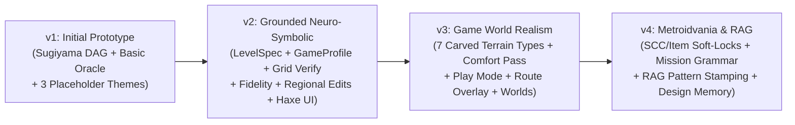

# GLDtk: A Neuro-Symbolic, Mixed-Initiative Pipeline for Statically Verified 2D Platformer Level Generation in LDtk

**Thesis Topic:** Game World Modeling Using Machine Learning Methods  
**Armenian Title:** Խաղային աշխարհների մոդելավորում մեքենայական ուսուցման մեթոդներով  
**Institution:** National Polytechnic University of Armenia (Հայաստանի ազգային պոլիտեխնիկական համալսարան — ՀԱՊՀ / NPUA)  
**System Name:** GLDtk (*Generative Level Design Toolkit*)  
**Target Environment:** LDtk 1.5.3 (Level Designer Toolkit) — Native Haxe/Electron Sidebar & Standalone App  

---

## Abstract

Designing 2D platformer game worlds is a labor-intensive process requiring simultaneous mastery of spatial geometry, player movement kinematics, progression logic, and visual composition. Existing automated approaches face a fundamental **Procedural Content Generation (PCG) Trilemma**: (1) *Classical constructive and constraint-based generators* (e.g., WaveFunctionCollapse, Tanagra, Dormans' mission grammars) guarantee local consistency or topological validity but lack open-ended natural language controllability; (2) *Pure Machine Learning and Large Language Model (LLM) generators* (e.g., MarioGPT, Word2World, direct tile-grid prompting) offer rich semantic expressiveness from text prompts but suffer from severe *spatial blindness*—producing physically impossible jump gaps, low-ceiling collisions, unreachable collectibles, and irreversible soft-locks; and (3) *Academic mixed-initiative prototypes* (e.g., Sentient Sketchbook, Morai Maker) remain isolated in standalone research sandboxes divorced from production level editors.

This thesis presents **GLDtk (Generative Level Design Toolkit)**, a neuro-symbolic, mixed-initiative pipeline embedded natively inside **LDtk** as a Haxe sidebar panel. GLDtk decouples **semantic intent** (handled by schema-constrained cloud or local LLMs, augmented by a Retrieval-Augmented Generation pattern library and cross-project Design Memory) from **geometric realization and formal verification** (handled by deterministic procedural rock carvers, a closed-form kinematic Physics Oracle, and graph-theoretic state-space model checking). Every candidate level or regional edit is statically verified before export: swept $12 \times 24\text{ px}$ AABB hitbox trajectories validate parabolic jumps ($\frac{1}{2}gt^2 - vt + \Delta y = 0$), chained double-jumps ($\mathcal{O}(1)$ analytical optimal launch time $\tau^*$), air dashes, wall-jump climbs, and piecewise cross-section gravity fields. Furthermore, GLDtk proves global **soft-lock freedom**—guaranteeing that from *every* reachable platform and inventory state, an Exit remains reachable—using Tarjan's Strongly Connected Components (SCC) condensation and a bounded Item-State Product Automaton ($\mathcal{S} = V_{\text{standable}} \times \mathcal{P}(\text{Items})$).

Across empirical evaluations, GLDtk achieves **100% verified playability**, **0% exported soft-locks**, **0.95–1.00 prompt fidelity** on frontier models, boosts local 14B open-weight model (`qwen2.5:14b`) verification success from **0% (0/6) to 83.3% (5/6)** via deterministic symbolic patching alone, achieves **100% (4/4) RAG pattern stamping coverage** across all structural terrain types at heights of 20–40 tiles, and accelerates end-to-end multi-section level authoring by **4.89×** compared to manual editing in LDtk (**1m 13s vs. 5m 57s**).

---

## 1. Introduction: What Was the Original Idea of This Project?

### 1.1 Motivation and Thesis Assignment
In modern video game production, level design is a primary bottleneck. A 2D platformer level is not merely an artistic arrangement of tiles; it is a formal spatial program governed by continuous Newtonian kinematics and discrete state transitions. When a human designer places two ledges separated by a pit of spikes, they must mentally simulate the player's horizontal run speed ($v_x$), upward jump impulse ($v_y$), gravitational acceleration ($g$), hitbox clearance ($w \times h$), and available movement abilities (double jump, dash, wall jump).

As formulated in the official thesis assignment ([`Assignment.docx`](file:///Users/bekiryan/Projects/GLDtk/Assignment.docx) / [`Առաջադրանք.docx`](file:///Users/bekiryan/Projects/GLDtk/Առաջադրանք.docx)) and the initial architecture proposal ([`Generative-Level-Design-Toolkit.pdf`](file:///Users/bekiryan/Projects/GLDtk/Generative-Level-Design-Toolkit.pdf)), the core idea of this thesis was to answer a central research question:

> **Research Question:** *Can we combine the natural-language semantic creativity of Large Language Models (System 1) with deterministic symbolic physics verification, graph grammars, and procedural geometry engines (System 2) inside a production level editor (LDtk), such that a designer can describe or iteratively edit a 2D platformer world in plain language and receive a level that is mathematically proven to be beatable, soft-lock free, and faithful to their prompt?*

### 1.2 The Four-Generation Evolution of the Idea (v1 $\to$ v4)
While the foundational neuro-symbolic thesis remained constant, building and testing the system revealed deep practical challenges that drove four distinct architectural generations:

1. **v1 — The Initial Topological Prototype ([`Generative-Level-Design-Toolkit.pdf`](file:///Users/bekiryan/Projects/GLDtk/Generative-Level-Design-Toolkit.pdf)):**
   - The LLM generated a bare topological directed graph (`AbstractLevelGraph` in [`symbolic/schema.py`](file:///Users/bekiryan/Projects/GLDtk/symbolic/schema.py)) with nodes (`PLATFORM`, `START`, `EXIT`, `HAZARD`) and edges (`WALK`, `JUMP`, `FALL`).
   - A 4-phase **Sugiyama hierarchical graph drawing algorithm** ([`layout/sugiyama.py`](file:///Users/bekiryan/Projects/GLDtk/layout/sugiyama.py)) assigned layers and grid coordinates, placing 1-tile-thick platforms in empty space.
   - A kinematic **Physics Oracle** ([`symbolic/physics.py`](file:///Users/bekiryan/Projects/GLDtk/symbolic/physics.py)) checked jump edges via $\frac{1}{2}gt^2 - vt + \Delta y = 0$, and a `SymbolicPatcher` repaired invalid edges.
2. **v2 — Grounded Specification, Raster Re-Verification & Mixed-Initiative Editing ([`docs/v2/DESIGN.md`](file:///Users/bekiryan/Projects/GLDtk/docs/v2/DESIGN.md)):**
   - Replaced bare graphs with a strict Pydantic v2 [`LevelSpec`](file:///Users/bekiryan/Projects/GLDtk/spec/level_spec.py) schema enforcing canvas dimensions, ordered thematic sections, a 9-kind typed entity catalog ([`spec/catalog.py`](file:///Users/bekiryan/Projects/GLDtk/spec/catalog.py)), and verifiable prompt requirements.
   - Unbundled physics into a per-project [`GameProfile`](file:///Users/bekiryan/Projects/GLDtk/game/profile.py) (`gldtk.game.json`) supporting `double_jump`, `dash`, `wall_jump`, and per-section `gravity_scale`.
   - Added **Grid-Level Physics Re-Verification** ([`layout/verify.py`](file:///Users/bekiryan/Projects/GLDtk/layout/verify.py)): instead of trusting abstract graph edges, GLDtk extracts the actual standable spans from the final rasterized tile grid ([`symbolic/extractor.py`](file:///Users/bekiryan/Projects/GLDtk/symbolic/extractor.py)) and sweeps the player's $12 \times 24\text{ px}$ hitbox along every trajectory.
   - Added **Seam-Locked Regional Editing** ([`edit/`](file:///Users/bekiryan/Projects/GLDtk/edit)) and a **Fidelity & Completeness Engine** ([`fidelity/`](file:///Users/bekiryan/Projects/GLDtk/fidelity), [`pipeline/completeness.py`](file:///Users/bekiryan/Projects/GLDtk/pipeline/completeness.py)), integrated natively into LDtk via Haxe ([`GldtkSidebar.hx`](file:///Users/bekiryan/Projects/GLDtk/ldtk-src/src/electron.renderer/ui/GldtkSidebar.hx)).
3. **v3 — Playable Game World Realism & In-Editor Simulation ([`docs/v3/PLAN.md`](file:///Users/bekiryan/Projects/GLDtk/docs/v3/PLAN.md)):**
   - Moved away from "floating platforms in an empty void" by introducing **7 Procedural Section Structure Types** (`corridor`, `parkour`, `labyrinth`, `arena`, `shaft`, `hub`, `open`) in [`layout/terrain/`](file:///Users/bekiryan/Projects/GLDtk/layout/terrain) that carve floors, walls, ceilings, and rooms out of solid rock.
   - Added **Walk-First Comfort Limits** ([`layout/comfort.py`](file:///Users/bekiryan/Projects/GLDtk/layout/comfort.py)), a **Difficulty Curve Analyzer** ([`fidelity/difficulty.py`](file:///Users/bekiryan/Projects/GLDtk/fidelity/difficulty.py)), a live **Canvas Route Overlay**, an interactive 60 Hz **▶ Play Mode** inside LDtk, **Multi-Level Worlds** ([`pipeline/world.py`](file:///Users/bekiryan/Projects/GLDtk/pipeline/world.py)), and standalone macOS `.dmg` packaging ([`scripts/build_mac_app.sh`](file:///Users/bekiryan/Projects/GLDtk/scripts/build_mac_app.sh)).
4. **v4 — Metroidvania Progression, Soft-Lock Freedom, RAG Pattern Stamping & Design Memory ([`docs/v4/PLAN.md`](file:///Users/bekiryan/Projects/GLDtk/docs/v4/PLAN.md)):**
   - Upgraded verification from *"Start $\to$ Exit exists"* to *"No reachable state can ever trap the player"* via **SCC Condensation + Item-State Product Graph Analysis** ([`layout/softlock.py`](file:///Users/bekiryan/Projects/GLDtk/layout/softlock.py)).
   - Added **Dormans-Style Mission Graph Grammars** ([`mission/`](file:///Users/bekiryan/Projects/GLDtk/mission)) for lock-and-key cycles, ability gates, and shortcut loops.
   - Built a **RAG Pattern Library & Stamping Engine** ([`patterns/`](file:///Users/bekiryan/Projects/GLDtk/patterns), [`pipeline/stamps.py`](file:///Users/bekiryan/Projects/GLDtk/pipeline/stamps.py)) over open-licensed games (*SuperTux*, *Open Surge*, LDtk samples) with multimodal vision labeling ([`patterns/vision.py`](file:///Users/bekiryan/Projects/GLDtk/patterns/vision.py)).
   - Added **Cross-Project Design Memory** ([`memory/`](file:///Users/bekiryan/Projects/GLDtk/memory)), **Closed-Loop Complexity Control** ([`pipeline/complexity.py`](file:///Users/bekiryan/Projects/GLDtk/pipeline/complexity.py)), and **Endless Seeded Chunks** ([`pipeline/chunks.py`](file:///Users/bekiryan/Projects/GLDtk/pipeline/chunks.py)).

---

## 2. What Problems Are We Trying to Solve & What Issues Did We Encounter?

### 2.1 The Fundamental Domain Problems
1. **LLM Spatial Blindness & Coordinate Hallucination:** Autoregressive language models process 1D token sequences and fail at 2D pixel/tile geometry, frequently placing platforms outside canvas bounds, overlapping solid walls, or separated by chasms exceeding maximum jump reach.
2. **Lack of Playability & Soft-Lock Guarantees:** Pure neural generators (like MarioGPT or direct grid prompting) offer zero formal guarantees that an Exit is reachable, that ceilings do not block the player's hitbox, or that one-way drops and locked doors do not permanently soft-lock the player.
3. **Destructive "All-or-Nothing" Generation:** Standard text-to-level pipelines regenerate the entire level from scratch on every prompt, destroying any manual refinements a human level designer has made.
4. **Disconnect Between Research Prototypes and Industry Tools:** Academic level generators typically output custom ASCII files or run in isolated web sandboxes rather than exporting valid, schema-compliant projects inside production editors like LDtk.

### 2.2 Ten Concrete Engineering Issues We Encountered and How We Solved Them

During development from v1 through v4 (documented in [`docs/v2/PROGRESS.md`](file:///Users/bekiryan/Projects/GLDtk/docs/v2/PROGRESS.md)), ten critical engineering failure modes surfaced and were systematically solved:

| # | Issue Encountered | Root Cause | Architectural Solution Engineered |
|---|---|---|---|
| **1** | **Levels felt like "floating parkour in a void"** (v1–v2) | Sugiyama layout and early `spec_layout` placed isolated 1-tile-thick platforms in empty air, unlike real games (*Spelunky 2*, *Dead Cells*, *Blasphemous 2*). | **Section Structure Carvers (Part 21, [`layout/terrain/`](file:///Users/bekiryan/Projects/GLDtk/layout/terrain))**: 7 procedural generators (`corridor`, `parkour`, `labyrinth`, `arena`, `shaft`, `hub`, `open`) carve enclosed rooms, floors, walls, and ceilings from solid rock with matched boundary ports. |
| **2** | **Floaty, unnatural 11.5-tile jumps** (v1–v3) | Early defaults ($g=980\text{ px/s}^2, v=600\text{ px/s}$) gave huge 11.5-tile-high, 15-tile-wide arcs, and uniform edge weights made 1 giant jump cheaper than 3 short hops. | **Tighter Physics & Effort-Based Routing (Parts 20 & 28, [`game/profile.py`](file:///Users/bekiryan/Projects/GLDtk/game/profile.py), [`layout/comfort.py`](file:///Users/bekiryan/Projects/GLDtk/layout/comfort.py))**: Retuned defaults to $g=1800, v=500, v_x=220$ (~4.3-tile rise, ~7.6-tile hop); added super-linear jump effort costs and comfort pass (`hop <= 4`, `rise <= 3`, `drop <= 6` tiles). |
| **3** | **LLM omitted requested entities or hallucinated counts** (M1 Demo) | On a 3-section, 11-requirement prompt, `gemini-3.1-flash-lite` listed all 11 requirements in JSON but emitted only 5 entities (omitting coins, bats, chest, boss). | **Deterministic Completeness Fill (Part 7 & PR #8, [`pipeline/completeness.py`](file:///Users/bekiryan/Projects/GLDtk/pipeline/completeness.py), [`fidelity/fill.py`](file:///Users/bekiryan/Projects/GLDtk/fidelity/fill.py))**: Deterministically synthesizes missing entities, start items, hazards, structure types (`P_<type>`), and lock-key cycles before layout, needing $\le 1$ LLM re-prompt. |
| **4** | **Walk spans under 1-tile ceilings & cross-section gravity errors** (Part 3) | Early grid extraction checked surface tiles without checking if the $12\times 24\text{ px}$ player could stand upright; arcs crossing section borders used only launch-section gravity. | **Headroom Splitting & Piecewise Gravity Integration (Part 11, [`symbolic/extractor.py`](file:///Users/bekiryan/Projects/GLDtk/symbolic/extractor.py), [`symbolic/gravity.py`](file:///Users/bekiryan/Projects/GLDtk/symbolic/gravity.py))**: Splits spans wherever $\lceil h_{\text{hitbox}}/16 \rceil = 2$ empty overhead tiles are missing; integrates path-moment gravity $G = 2\int_0^1 (1-\sigma)g(x(\sigma))d\sigma$ across column/row bands. |
| **5** | **Players getting trapped in pits or behind locked doors** (v1–v3) | Verifier only checked that *some* path $\text{Start} \to \text{Exit}$ existed, ignoring inescapable pits or dropping past a required key. | **SCC Condensation & Item-State Product Graph (Part 22, [`layout/softlock.py`](file:///Users/bekiryan/Projects/GLDtk/layout/softlock.py), [`layout/softlock_repair.py`](file:///Users/bekiryan/Projects/GLDtk/layout/softlock_repair.py))**: Condenses movement graph into Tarjan SCCs and verifies backward liveness over $(u, H) \in V_{\text{standable}} \times \mathcal{P}(\text{Items})$; auto-repairs traps with stepping-stone escape ladders or key relocation. |
| **6** | **Sparse canvases & entity crowding on 3-tile ledges** (M1–M2) | LLMs placed 8–10 platforms in a $120 \times 30$ level and stacked coins, enemies, and checkpoints onto the same 3-tile platform. | **Crowding Relocation & Chebyshev Densification (Parts 7b & 9b, [`layout/densify.py`](file:///Users/bekiryan/Projects/GLDtk/layout/densify.py))**: Enforces $\le 1$ entity per 2 tiles (widening ledges or moving excess entities); uses a 2D Chebyshev distance transform to infill empty air with reachable platforms outside protected route arcs. |
| **7** | **Gemini Free-Tier 429 Quota & 503 High-Demand Outages** (M2–M4) | Gemini free tier caps Flash at ~20 requests/day and frequently returns HTTP 503 `UNAVAILABLE`, halting live editing and evaluations. | **Multi-Tier Provider Fallback & 503 Backoff (PR #6, [`llm/providers/`](file:///Users/bekiryan/Projects/GLDtk/llm/providers), [`eval/providers.py`](file:///Users/bekiryan/Projects/GLDtk/eval/providers.py))**: Retries 503s at `20s, 60s, 120s`, cascades `gemini-3.8-flash` $\to$ `gemini-3.1-flash-lite` $\to$ local `ollama:qwen2.5:14b`, and logs `answered_by`. |
| **8** | **Local `qwen2.5:14b` failed 6/6 structure prompts (0% pass)** (Run `2026-10-16`) | Qwen emitted `complexity` on a $0\dots 10$ scale (violating $\le 1.0$), placed entities on hazards, emitted out-of-bounds coordinates, and labeled steep climbs as `Walk`. | **Symbolic Normalization & Partial Patching (PR #7, [`llm/patcher.py`](file:///Users/bekiryan/Projects/GLDtk/llm/patcher.py), [`llm/validator.py`](file:///Users/bekiryan/Projects/GLDtk/llm/validator.py))**: Added `SpecNormalizePatch`, rescaled complexity, reclassified steep Walk edges, and retained valid partial patches across retries—raising Qwen replay verification from **0/6 (0%) to 5/6 (83.3%)**. |
| **9** | **LDtk blank canvas on reload, washed-out tiles & dirty `*` flag** (Parts 7b, 9, 9b) | `App.loadProject` race-disposed the active editor; `Collisions` layer sat above `Tiles`; mismatched `defs.layers` order made `Level.tidy()` mark files unsaved (`*`). | **In-Place Project Swap & Schema-Exact Export ([`layout/ldtk_adapter.py`](file:///Users/bekiryan/Projects/GLDtk/layout/ldtk_adapter.py), [`GldtkSidebar.hx`](file:///Users/bekiryan/Projects/GLDtk/ldtk-src/src/electron.renderer/ui/GldtkSidebar.hx))**: Matched `Entities -> Tiles -> Collisions` order, pre-populated `cachedPixelData`/`__smartColor`, fixed ~45 v1 schema bugs against `JSON_SCHEMA.json`, and swapped projects via `ProjectLoader` + `editor.selectProject`. |
| **10** | **RAG Pattern Stamping failed on tall sections & rare structures** (Parts 26b–29g) | Early pattern index lacked `labyrinth`, `arena`, and `hub` windows, and 20-row windows failed when stretched into 34–40-row sections. | **Geometry Classifier, Gap Ingest & Route-Checked Padding (Parts 26f, 29g, PRs #10–#11, [`patterns/classify.py`](file:///Users/bekiryan/Projects/GLDtk/patterns/classify.py), [`layout/terrain/stamp.py`](file:///Users/bekiryan/Projects/GLDtk/layout/terrain/stamp.py))**: Classified windows via graph cycle rank ($E-V+C$) and room enclosure, ingested +641 gap windows, padded narrow/short stamps with rock instead of stretching, and required `level_route` traversal—reaching **4/4 stamping across all terrain types at heights 20–40**. |

---

## 3. Related Work, Theoretical Sources & Literature Review

To design GLDtk, we synthesized methods from five distinct research traditions in procedural content generation, formal verification, and human-AI co-creativity. (See [`docs/thesis/LITERATURE_AND_SOURCES.md`](file:///Users/bekiryan/Projects/GLDtk/docs/thesis/LITERATURE_AND_SOURCES.md) for the complete annotated bibliography and BibTeX database.)

### 3.1 Foundational PCG Textbooks & Surveys
1. **Shaker, Togelius, & Nelson (2016), *Procedural Content Generation in Games* (Springer):** Establishes the taxonomy of *constructive* methods (fast, single-pass, unverified) vs. *search-based / generate-and-test* methods, as well as cellular automata and fractals/noise (Chapter 3) and grammar-based generation (Chapter 5). GLDtk combines constructive rock carving and cellular-automata-smoothed fBm noise ([`layout/noise.py`](file:///Users/bekiryan/Projects/GLDtk/layout/noise.py)) with fast analytical verification.
2. **Summerville et al. (2018), *Procedural Content Generation via Machine Learning (PCGML)* (*IEEE Trans. Games*):** Identifies the central flaw of pure ML level generation—statistical models trained on tile matrices lack domain constraints and frequently emit unplayable levels. GLDtk resolves this by never allowing the neural model to paint raw collision tiles directly.
3. **Togelius et al. (2011), *Search-Based Procedural Content Generation* (*IEEE TCIAIG*):** Formalizes fitness-driven generation. Rather than running thousands of slow evolutionary simulations, GLDtk uses a closed-form physics oracle ($\mathcal{O}(1)$ per jump) and a deterministic closed-loop complexity controller ([`pipeline/complexity.py`](file:///Users/bekiryan/Projects/GLDtk/pipeline/complexity.py)).
4. **Short & Adams (2017), *Procedural Generation in Game Design* (CRC Press):** Details industry room-chunk composition (notably Derek Yu's *Spelunky* architecture), directly informing GLDtk's section structure generators, port seams, and comfort-first pacing.

### 3.2 LLM-Based Level Generation (2023–2026)
5. **Sudhakaran et al. (2023), *MarioGPT: Open-Ended Text2Level Generation through Large Language Models* (*NeurIPS 2023*):** Fine-tunes GPT-2 to output *Super Mario Bros.* tile columns from text prompts. Because MarioGPT predicts raw tile characters autoregressively, it frequently generates impassable gaps or broken pipes and requires post-hoc A* simulation. GLDtk replaces raw tile prediction with schema-enforced topological specification (`LevelSpec`) and static multi-ability physics verification.
6. **Todd et al. (2023), *Level Generation Through Large Language Models* (*FDG '23*):** Demonstrates that off-the-shelf LLMs struggle with 2D spatial reasoning and global solvability in *Sokoban*. GLDtk overcomes this spatial blindness via semantic anchors (`place: "room" | "dead_end" | "arena_center"`) and deterministic `SymbolicPatcher` repair.
7. **Nasir, James, & Togelius (2024), *Word2World: Generating Stories and Worlds through Large Language Models* (*IEEE CoG 2024*):** Translates LLM narratives into 2D top-down RPG grids. GLDtk extends narrative-to-world generation to gravity-governed side-scrolling platformers and adds an explicit `FidelityChecker` ([`fidelity/checker.py`](file:///Users/bekiryan/Projects/GLDtk/fidelity/checker.py)) that audits every prompt requirement against the final level.
8. **Taveekitworachai et al. (2023, 2024), *ChatGPT4PCG Competition* (*IEEE CoG*):** Highlights the fragility of prompt-to-physics generation in *Science Birds*, motivating GLDtk's strict JSON-schema decoding and closed-form kinematic checks.

### 3.3 Constraint-Based, Grammar-Based & Mission-Space Systems
9. **Dormans (2010), *Adventures in Level Design: Generating Missions and Spaces for Action Adventure Games* (*PCG '10*) & Dormans & Bakkes (2011) (*IEEE TCIAIG*):** Introduces the separation of **Mission Graphs** (logical task/key/lock ordering generated via graph-rewriting grammars) from **Space Graphs** (physical room topology). GLDtk's [`mission/`](file:///Users/bekiryan/Projects/GLDtk/mission) package (`grammar.py`, `graph.py`, `space.py`, `verify.py`) directly implements Dormans' mission-space separation for 2D Metroidvania platformers.
10. **Smith, Whitehead, & Mateas (2010/2011), *Tanagra* & *Launchpad* (*IEEE TCIAIG*):** Pioneered mixed-initiative platformer design using reactive planning and numerical jump constraints. Whereas Tanagra arranged flat 1D sequences of floating rectangles for a single Mario jump, GLDtk carves enclosed 2D architectural structures (`labyrinth`, `hub`, `shaft`, `arena`), models chained abilities (`double_jump`, `dash`, `wall_jump`), and runs natively inside LDtk.
11. **Gumin (2016) & Karth & Smith (2017), *WaveFunctionCollapse (WFC)* (*FDG '17*):** Enforces local tile adjacency constraints via arc consistency, but cannot guarantee global Start $\to$ Exit reachability or prevent soft-locks.
12. **Cooper (2022), *Sturgeon: Tile-Based Procedural Level Generation via Learned and Designed Constraints* (*AIIDE '22*):** Compiles tile and path constraints to SAT/SMT/ASP solvers. GLDtk avoids exponential SAT/SMT blowup on large ($300 \times 100$) grids by solving kinematics analytically and soft-locks via linear-time Tarjan SCCs ($\mathcal{O}(V+E)$).

### 3.4 Platformer Kinematics, Reachability & Graph Drawing
13. **Summerville et al. (2016), *The VGLC: The Video Game Level Corpus* (*PCG '16*):** Standardizes tile-level game corpora. Because VGLC relies on proprietary Nintendo ROMs, GLDtk's pattern library ([`patterns/`](file:///Users/bekiryan/Projects/GLDtk/patterns)) strictly ingests only permissively licensed open-source games (*SuperTux* CC-BY-SA 4.0, *Open Surge* CC-BY 3.0/4.0, and MIT LDtk samples) and CC0 Kenney assets ([`assets/LICENSES.md`](file:///Users/bekiryan/Projects/GLDtk/assets/LICENSES.md)).
14. **Bauer, Cooper, & Popović (2013), *Automated Redesign of Local Playspace Properties* (*FDG '13*):** Uses reachability trees to mutate local platform geometry. GLDtk generalizes this in [`layout/repair.py`](file:///Users/bekiryan/Projects/GLDtk/layout/repair.py) and [`layout/softlock_repair.py`](file:///Users/bekiryan/Projects/GLDtk/layout/softlock_repair.py) via deterministic stepping-stone synthesis and ceiling nudging.
15. **Sugiyama, Tagawa, & Toda (1981), *Methods for Visual Understanding of Hierarchical System Structures* (*IEEE TSMC*):** The 4-phase layered DAG drawing algorithm adapted in [`layout/sugiyama.py`](file:///Users/bekiryan/Projects/GLDtk/layout/sugiyama.py) for open-air platform layouts.

### 3.5 Mixed-Initiative Co-Creativity & Production Level Editors
16. **Liapis, Yannakakis, & Togelius (2013), *Sentient Sketchbook* (*FDG '13*):** Pioneered real-time Playability/Difficulty feedback during map sketching. GLDtk brings this paradigm to 2D platformers via its live **Route Overlay** and per-section **Difficulty Curve** chart.
17. **Guzdial et al. (2019), *Morai Maker* (*CHI '19*):** Identified four human-AI co-creative roles (*Friend, Collaborator, Student, Manager*) and showed that designers resent AI overwriting their manual work. GLDtk protects designer agency via **Seam-Locked Regional Editing** ([`edit/`](file:///Users/bekiryan/Projects/GLDtk/edit)) and operationalizes the *Student* role via **Cross-Project Design Memory** ([`memory/`](file:///Users/bekiryan/Projects/GLDtk/memory)).
18. **Sébastien Bénard (deepnight) (2017–present), *Dead Cells* Level Design Pipeline & *LDtk*:** *Dead Cells* popularized combining macro-level cyclic mission graphs with micro-level hand-authored room stamps. GLDtk directly implements this hybrid philosophy inside Bénard's own **LDtk** editor by stamping retrieved open-source room patterns ([`layout/terrain/stamp.py`](file:///Users/bekiryan/Projects/GLDtk/layout/terrain/stamp.py)) into Dormans-style mission spaces.

### 3.6 Comparative Matrix: GLDtk vs. Existing Solutions

| Capability / Dimension | Pure LLM Generators *(MarioGPT, Todd et al., Word2World)* | Constraint / Grammar Systems *(Tanagra, WFC, Sturgeon, Dormans)* | Mixed-Initiative Prototypes *(Sentient Sketchbook, Morai Maker)* | Manual Editor Authoring *(Standard LDtk, Tiled)* | **GLDtk (This Thesis)** *(Neuro-Symbolic LDtk Pipeline)* |
|---|---|---|---|---|---|
| **Natural Language Control** | ✅ High (free-form prompts) | ❌ None (code/rules/grammars) | ❌ None (sketch/brush only) | ❌ None (manual tile painting) | ✅ **Full** (prompts for worlds, levels, regions, entities) |
| **Playability Guarantee** | ❌ None (frequent impossible gaps) | ✅ High (solver/grammar bound) | ⚠ Partial (heuristic/agent) | ❌ Manual QA only | ✅ **100% Statically Proven** (swept-hitbox Physics Oracle) |
| **Soft-Lock Freedom** | ❌ None (unmonitored traps) | ⚠ Partial (mission-only or local) | ❌ None | ❌ Manual QA only | ✅ **Guaranteed** (Tarjan SCC + $S \times 2^I$ Item-State Graph) |
| **Multi-Ability Physics** | ❌ None | ⚠ Single Mario jump only | ❌ Coarse / abstract | ❌ Designer mental math | ✅ **Full** (double jump, air dash, wall jump, section gravity) |
| **Non-Destructive Regional Edit** | ❌ Re-rolls whole level | ⚠ Limited infilling | ⚠ Can overwrite user work | ✅ Manual brush | ✅ **Seam-Locked Co-Creation** (region, section, entity, locate) |
| **Mission / Key-Lock Loops** | ❌ Weak long-horizon planning | ✅ Dormans graph grammars | ❌ None | ⚠ Manual wiring | ✅ **Dual Mission + Space Embedding** with counterfactual verify |
| **Learns Designer Taste** | ❌ Stateless | ❌ Static parameters | ⚠ Session-only | ❌ Passive tool | ✅ **Cross-Project Design Memory** (learns from hand edits/undos) |
| **Production Editor Integration** | ❌ CLI / ASCII scripts | ❌ Standalone prototypes | ❌ Standalone academic UI | ✅ Native desktop app | ✅ **Native Haxe Sidebar inside LDtk 1.5.3 + Standalone `.dmg`** |

---

## 4. What Project We Built: System Architecture & Mathematical Formulations

### 4.1 End-to-End 11-Stage Neuro-Symbolic Pipeline
The complete pipeline (`build_level` in [`pipeline/level.py`](file:///Users/bekiryan/Projects/GLDtk/pipeline/level.py); multi-level worlds in [`pipeline/world.py`](file:///Users/bekiryan/Projects/GLDtk/pipeline/world.py); endless chunks in [`pipeline/chunks.py`](file:///Users/bekiryan/Projects/GLDtk/pipeline/chunks.py)) executes 11 deterministic and neural-guided stages:

```mermaid
flowchart TD
    P["1. User Prompt + GameProfile\n+ RAG Patterns (patterns/) + Design Memory (memory/)"] --> LLM["2. LLMController (llm/validator.py)\nSchema-Enforced Generation -> Validate -> SymbolicPatcher (llm/patcher.py)"]
    LLM --> COMP["3. Completeness & Fidelity Loop (pipeline/completeness.py, fidelity/)\nDeduce Implicit Requirements -> Deterministic Fill -> <=1 Re-Prompt"]
    COMP --> MISS["4. Mission Graph Grammar & Space Embedding (mission/)\nLock-Key Cycles, Ability Gates, Shortcut Loops, Boss Arenas"]
    MISS --> TERR["5. Section Terrain Carving & Stamp Injection (layout/terrain/, pipeline/stamps.py)\n7 Carvers (corridor, parkour, labyrinth, arena, shaft, hub, open) + RAG Stamps"]
    TERR --> VER["6. Grid Extraction, Hitbox-Swept Verify & Soft-Lock Repair\n(symbolic/extractor.py, layout/verify.py, layout/softlock.py, layout/repair.py)"]
    VER --> COMF["7. Walk-First Comfort Pass & Chebyshev Densification\n(layout/comfort.py, layout/densify.py)"]
    COMF --> CPLX["8. Closed-Loop Complexity Controller (pipeline/complexity.py)\nMeasure 5-Factor Difficulty (fidelity/difficulty.py) -> Adjust Toward Target"]
    CPLX --> FILL["9. Domain-Warped fBm Noise Rock Fill (layout/fill.py, layout/noise.py)\n4-5 Cellular Automata Smoothing Outside Protected Route Envelope"]
    FILL --> AES["10. Aesthetic Layer (aesthetic/)\n8 CC0 Themes, 14-Role Autotiling, 25 Packed Entity Sprites"]
    AES --> EXP["11. LDtk 1.5.3 JSON Serializer & Native Sidebar Reload\n(layout/ldtk_adapter.py -> GldtkSidebar.hx -> In-Editor Play & Route Overlay)"]
```

### 4.2 Mathematical Formulation of the Kinematic Physics Oracle
Implemented in [`symbolic/physics.py`](file:///Users/bekiryan/Projects/GLDtk/symbolic/physics.py), [`symbolic/walljump.py`](file:///Users/bekiryan/Projects/GLDtk/symbolic/walljump.py), and [`symbolic/gravity.py`](file:///Users/bekiryan/Projects/GLDtk/symbolic/gravity.py), the Physics Oracle validates transitions in a $Y$-up world coordinate frame ($1\text{ tile} = 16\text{ px}$).

#### 1. Standard Parabolic Jump Kinematics
Given launch point $p_1 = (x_1, y_1)$ and target landing point $p_2 = (x_2, y_2)$ with displacements $\Delta x = x_2 - x_1$ and $\Delta y = y_2 - y_1$, downward gravity $g > 0$, maximum vertical jump impulse $v_y \in (0, v_{\text{jump}}]$, and horizontal run speed $|v_x| \le v_{\text{run}}$, the vertical motion satisfies:
$$\frac{1}{2} g (t^*)^2 - v_y t^* + \Delta y = 0$$
The discriminant is:
$$D = v_y^2 - 2 g \Delta y$$
- If $D < 0$, the apex height $h_{\max} = \frac{v_y^2}{2g} < \Delta y$, so the target is unreachable.
- If $D \ge 0$, the ascending and descending roots are $t_{1,2} = \frac{v_y \mp \sqrt{D}}{g}$. The jump is valid if $\exists t^* \in \{t_1, t_2\}$ with $t^* > 0$ such that:
  $$\left| \frac{\Delta x}{t^*} \right| \le v_{\text{run}} + \varepsilon \quad (\varepsilon = 10^{-9})$$
  The descending root $t_2 = \frac{v_y + \sqrt{D}}{g}$ maximizes flight duration and therefore maximizes horizontal reach $|\Delta x|$.

#### 2. Closed-Form $\mathcal{O}(1)$ Double-Jump Optimal Apex Chaining
When `double_jump` is enabled with first impulse $v_1$ and second impulse $v_2$ triggered at flight time $\tau \in [0, 2v_1/g]$, the height at $\tau$ is $h(\tau) = v_1\tau - \frac{1}{2}g\tau^2$. Launching the second jump from $h(\tau)$ yields remaining flight time $s(\tau) = \frac{v_2 + \sqrt{D(\tau)}}{g}$, where:
$$D(\tau) = v_2^2 + 2g(h(\tau) - \Delta y) = v_1^2 + v_2^2 - 2g\Delta y - (g\tau - v_1)^2$$
Total flight time $T(\tau) = \tau + s(\tau)$ is strictly concave over valid $\tau$. Setting $\frac{dT}{d\tau} = 1 + \frac{v_1 - g\tau}{\sqrt{D(\tau)}} = 0$ yields the exact analytical optimum $\tau^*$ without numerical search:
$$\tau^* = \min\left( \frac{v_1 + \sqrt{\frac{v_1^2 + v_2^2 - 2g\Delta y}{2}}}{g}, \frac{2v_1}{g} \right)$$
Validated in [`tests/test_abilities.py`](file:///Users/bekiryan/Projects/GLDtk/tests/test_abilities.py) against 20,000 brute-force $\tau$-grid searches with zero mismatches.

#### 3. Air Dash, Wall-Jump Climbs & Piecewise Cross-Section Gravity
- **Air Dash (`check_dash_jump`):** Subtracts horizontal dash displacement $d_{\text{dash}}$ from $|\Delta x|$ ($|\Delta x|' = \max(0, |\Delta x| - d_{\text{dash}})$) with zero vertical drop during the dash segment, sweeping the hitbox across split fractions $\phi \in \{0.5, 0.0, 1.0, 0.25, 0.75\}$.
- **Wall-Jump Envelope (`symbolic/walljump.py`):** Detects solid vertical `WallFace` runs ($\ge \text{player\_height}$ tiles) and executes a depth-bounded search ($\text{MAX\_KICKS} = 6$, $\text{MAX\_ARCS} = 400$) with kick velocity $v_{\text{kick}} = \min(v_{\text{wall}}, \sqrt{2g \cdot \text{max\_climb\_px}})$ and lateral push $t_{\text{push}} = \frac{\text{push\_px}}{v_{\text{run}}}$.
- **Piecewise Gravity Field (`symbolic/gravity.py`):** When an arc crosses column-band sections with distinct `gravity_scale` values, vertical displacement over flight duration $T$ satisfies the exact path-moment integral:
  $$y(T) - y_0 = v_y T - \frac{1}{2} G T^2, \quad G = 2 \int_0^1 (1 - \sigma) g(x_0 + \sigma \Delta x)\,d\sigma$$
- **Swept Hitbox Collision (`trajectory_clear`):** Every arc is sampled at $\Delta s \le 6.0\text{ px}$ steps, sweeping the player's $12 \times 24\text{ px}$ AABB hitbox against solid and hazard tiles.

### 4.3 Soft-Lock Detection & Repair via SCCs and Product Automata
Implemented in [`layout/softlock.py`](file:///Users/bekiryan/Projects/GLDtk/layout/softlock.py) and [`layout/softlock_repair.py`](file:///Users/bekiryan/Projects/GLDtk/layout/softlock_repair.py), GLDtk enforces two formal properties:

1. **Movement Graph SCC Liveness:**
   Let $G_{\text{sub}} = (V_{\text{standable}}, E)$ be the extracted platform movement graph. Tarjan's algorithm condenses $G_{\text{sub}}$ into a DAG of strongly connected components $\mathcal{C}$. A component $C \in \mathcal{C}$ is *live* iff it contains an `Exit` span or has a directed path in $\mathcal{C}$ to a live component:
   $$V_{\text{trap}} = V_{\text{reachable}}(\text{Start}) \setminus V_{\text{live}}$$
   If $V_{\text{trap}} \ne \emptyset$, each weakly connected trap component is classified as a `pit` (entered via a one-way fall) or `sealed` trap and repaired by inserting a chain of up to 4 stepping stones (`find_stone`).
2. **Inventory-State Product Automaton ($\mathcal{S} = V_{\text{standable}} \times \mathcal{P}(\text{Items})$):**
   Tracks up to 6 keys and ability pickups ($2^6 = 64$ inventory subsets per span). A state $(u, H) \in \mathcal{S}$ is a logical soft-lock if $(u, H)$ is reachable from $(\text{Start}, \emptyset)$ but cannot reach any unlocked goal state $(v_{\text{exit}}, H_{\text{goal}})$. In addition, a counterfactual check tests $k_s \in \text{Reach}(G_{\text{sub}} \setminus \{d_s\}, \text{Start})$ to guarantee no key is placed behind the door it unlocks (`key_behind_door`).

### 4.4 Dormans Mission Grammars, 7 Terrain Carvers & RAG Pattern Stamping
- **Mission Grammar ([`mission/grammar.py`](file:///Users/bekiryan/Projects/GLDtk/mission/grammar.py)):** Rewrites linear section progressions using five production rules: `lock_key_cycle`, `ability_gate`, `shortcut_loop`, `treasure_branch`, and `boss_before_exit`, verified counterfactually in [`mission/verify.py`](file:///Users/bekiryan/Projects/GLDtk/mission/verify.py) (proving locks are neither impossible nor bypassable).
- **7 Terrain Carvers ([`layout/terrain/`](file:///Users/bekiryan/Projects/GLDtk/layout/terrain)):** `corridor`, `parkour`, `labyrinth` (recursive backtracker maze with 2:1 horizontal bias), `arena`, `shaft` (11-column alternating zigzag climb), `hub` (multi-door room with vertical side-branches), and `open`.
- **RAG Pattern Library & Multimodal Vision Labeling ([`patterns/`](file:///Users/bekiryan/Projects/GLDtk/patterns)):**
  - Contains **3,577 indexed records** (3,336 verified room windows from *SuperTux*, *Open Surge*, and LDtk samples, 199 whole levels, and 42 design notes; 3,282 768-dim embeddings).
  - [`patterns/classify.py`](file:///Users/bekiryan/Projects/GLDtk/patterns/classify.py) classifies fragments by movement graph cycle rank ($E - V + C$), dead-end count, and wall/ceiling enclosure.
  - [`patterns/vision.py`](file:///Users/bekiryan/Projects/GLDtk/patterns/vision.py) renders each fragment to a semantic PNG, prompts a Vision-Language Model (`gemini-3.5-flash-lite` or `qwen2.5vl:7b`) with exact ground-truth tile counts, and runs a post-hoc `false_claims` verifier to prevent hallucinated visual descriptions.
- **Cross-Project Design Memory ([`memory/`](file:///Users/bekiryan/Projects/GLDtk/memory)):** Diffs user hand-edits against generated snapshots ([`memory/handedit.py`](file:///Users/bekiryan/Projects/GLDtk/memory/handedit.py)), aggregates statistical preferences ([`memory/analyze.py`](file:///Users/bekiryan/Projects/GLDtk/memory/analyze.py)), and injects learned design rules into subsequent prompts.

---

## 5. Tools, Models, Libraries, and Assets Used

| Layer | Technologies, Models & Libraries | Purpose in GLDtk |
|---|---|---|
| **Backend & Core Engine** | Python 3.11+, FastAPI $\ge 0.111$, Uvicorn $\ge 0.29$, Pydantic v2, NetworkX $\ge 3.3$, Pillow $\ge 10$, `jsonschema` | HTTP API (`server.py` on port 8765), strict `LevelSpec` JSON schema generation, digraph/SCC algorithms, tileset/sprite sheet packing, LDtk schema validation. |
| **Frontend & Editor** | Haxe 4.3, Heaps.io (`h2d.Graphics`), Electron, HTML5 Canvas, `deepnightLibs` (`e1237f8`) | Native LDtk sidebar ([`GldtkSidebar.hx`](file:///Users/bekiryan/Projects/GLDtk/ldtk-src/src/electron.renderer/ui/GldtkSidebar.hx)), rectangular lasso tool (`GldtkAreaTool.hx`), canvas Route Overlay, SVG Difficulty Chart, 60 Hz in-editor Play Mode. |
| **Cloud LLMs & VLMs** | Google Gemini (`gemini-3.8-flash`, `gemini-3.7-flash`, `gemini-3.1-flash-lite`, `gemini-3.5-flash-lite`), Anthropic Claude (`claude-sonnet-5-5` with prompt caching), OpenAI (`gpt-4o-mini`), DeepSeek (`deepseek-chat`) | Schema-enforced `LevelSpec`, `RegionSpec`, and `WorldOutline` generation; pattern vision labeling; optional AI pixel-art theme/sprite synthesis (`gemini-3.1-flash-image`). |
| **Local Open-Weight Models** | Ollama: `qwen2.5:14b` (default local fallback), `llama3.1`, `qwen2.5vl:7b` (local vision), `nomic-embed-text` (768-dim embeddings) | Offline/zero-cost generation, automatic fallback on Gemini 429/503 errors, local pattern labeling and vector embedding. |
| **Licensed Assets & Corpora** | Kenney CC0 1.0 (*Tiny Dungeon*, *Tiny Town*, *1-Bit Pack*), LDtk MIT Samples, *SuperTux* (CC-BY-SA 4.0), *Open Surge* (CC-BY 3.0/4.0) | 8 curated $80 \times 64\text{ px}$ 14-role autotile themes, 25 entity sprites (`gldtk_assets/sprites.png`), and 3,336 verified level pattern windows ([`assets/LICENSES.md`](file:///Users/bekiryan/Projects/GLDtk/assets/LICENSES.md)). |
| **Packaging & Testing** | PyInstaller, `electron-builder`, GitHub Actions (`.github/workflows/release.yml`), `pytest` (737 offline tests), Playwright Electron harness | Standalone Apple Silicon `GLDtk.app` (322 MB) / `GLDtk-1.5.3-arm64.dmg` (144 MB), Windows bundle (`feat/windows-build`), deterministic offline test suite. |

---

## 6. Final Results & How We Measured Quality Against Existing Solutions

### 6.1 Quantitative Evaluation Metrics (`eval/metrics.py`)
Unlike text benchmarks that only check JSON syntax, GLDtk evaluates generated levels across seven grounded domain metrics:

1. **Playability Share ($\text{Verified Rate}$):** Fraction of prompts producing a level where `BuiltLevel.report.ok == True` (swept-hitbox path $\text{Start} \to \text{Exit}$ exists, all required collectibles/keys are reachable, key-lock order is valid, and 0 soft-locks exist).
2. **Prompt Fidelity Score ([`fidelity/report.py`](file:///Users/bekiryan/Projects/GLDtk/fidelity/report.py)):**
   $$\text{Fidelity} = \frac{N_{\text{satisfied}} + 0.5 \cdot N_{\text{approximated}}}{N_{\text{satisfied}} + N_{\text{approximated}} + N_{\text{impossible}} + N_{\text{missing}}}$$
3. **Soft-Lock Rate ([`layout/softlock.py`](file:///Users/bekiryan/Projects/GLDtk/layout/softlock.py)):** Number of inescapable movement SCCs or dead-end `(span, items_held)` states. Guaranteed to be **0%** on all exported levels.
4. **Symbolic Efficiency:** Mean LLM attempts (`llm_attempts_mean`), total LLM calls (`llm_calls_mean`), deterministic symbolic patches applied per level (`patches_mean`), and entities auto-filled (`entities_filled_mean`).
5. **Generation Latency:** Pure computation and model wall-clock time (`wall_mean_s`, `wall_p95_s`), excluding rate-limit and 503 backoff sleep intervals.
6. **Difficulty Curve & Closed-Loop Complexity Alignment ([`fidelity/difficulty.py`](file:///Users/bekiryan/Projects/GLDtk/fidelity/difficulty.py)):** 5-factor difficulty model (Jumps $W=3.0$, Enemies $W=3.0$, Hazards $W=2.5$, Narrow Platforms $W=1.5$, Recovery Relief $W=-1.0$, calibrated via $10 \cdot (\text{Raw}/10)^{0.75}$), testing whether measured difficulty lands within $\pm 1.5$ of the requested target range.
7. **RAG Pattern Stamping Coverage ([`patterns/coverage.py`](file:///Users/bekiryan/Projects/GLDtk/patterns/coverage.py)):** Fraction of sections stamped from verified real-game fragments across heights $\{20, 26, 32, 34, 40\}$.

### 6.2 Empirical Benchmark Results Across Runs (`eval/results/`)

| Benchmark Run | Model / Configuration | Prompts | Playable (Verified) | Soft-Locks Exported | Mean Fidelity | Mean LLM Attempts | Mean Symbolic Patches | Mean Wall Time (s) |
|---|---|---:|---:|---:|---:|---:|---:|---:|
| **`gemini-2026-10-15`** (Core Suite) | `gemini` (Flash default) | 8 | **100.0% (8/8)** | **0.0%** | **1.00** | 1.12 | 0.12 | 110.04s |
| **`gemini-2026-10-16`** (Complexity) | `gemini-3.1-flash-lite` | 2 | **100.0% (2/2)** | **0.0%** | **0.85** | 1.00 | 2.50 | 17.23s |
| **`gemini-2026-10-19c`** (Structures + Mission) | `gemini-3.7-flash` + `qwen2.5:14b` fallback | 6 | **100.0% (6/6)** | **0.0%** | **0.95** | 1.17 | 0.83 | 97.37s |
| **Qwen Pre-PR #7** (Raw Local 14B) | `ollama:qwen2.5:14b` (before normalizer) | 6 | **0.0% (0/6)** | — | — | 2.50 | 0.00 | 919.13s |
| **Qwen Post-PR #7** (With Symbolic Normalizer) | `ollama:qwen2.5:14b` (offline replay of exact same LLM outputs) | 6 | **83.3% (5/6)** | **0.0%** | **0.95+** | 1.00 (replay) | 3.0+ | **< 2.0s** (layout/verify only) |

### 6.3 Five Key Empirical Findings Proving GLDtk's Effectiveness

1. **Neuro-Symbolic Patching Turns Unusable Local 14B Model Outputs into Verified Levels (0% $\to$ 83.3%):**
   In the `2026-10-16` run, local `ollama:qwen2.5:14b` failed 6 out of 6 structure prompts (`0%` playable) due to out-of-bounds coordinates, $0\dots 10$ complexity scales, entities on hazards, and misclassified `Walk` climbs. Without changing a single token of Qwen's recorded responses, adding deterministic `SpecNormalizePatch`, `EdgeReclassifyPatch`, and partial patch retention (PR #7) enabled **5 of the 6 recorded Qwen outputs (83.3%)** to build and pass full swept-hitbox and soft-lock verification.
2. **4.89× Authoring Speedup Over Manual LDtk Level Design (`demo/` Benchmark, PR #3):**
   Using the automated side-by-side benchmark harness ([`docs/demo/SPEC.md`](file:///Users/bekiryan/Projects/GLDtk/docs/demo/SPEC.md)), building a 4-section crypt level (`corridor` $\to$ `parkour` $\to$ `labyrinth` $\to$ `arena`) manually in LDtk required **5 minutes 57 seconds (357s) and 311 editor interactions**, whereas generating and verifying the equivalent level via the GLDtk sidebar required **1 minute 13 seconds (73s) and 172 automated background steps**—a **4.89× reduction in authoring time** while adding mathematical playability and soft-lock guarantees that manual design lacks.
3. **Closed-Loop Complexity Control Accurately Steers Level Difficulty (Part 24):**
   When targeting a high complexity score on the crypt benchmark, the closed-loop controller ([`pipeline/complexity.py`](file:///Users/bekiryan/Projects/GLDtk/pipeline/complexity.py)) automatically measured the initial layout at **3.4 / 10** and iteratively adjusted hazard density, enemy threat, and jump tightness without extra LLM calls, raising the measured difficulty to **6.4 / 10** (within the target band). On `v4-complexity-low` and `v4-complexity-high`, 100% of runs landed within the $\pm 1.5$ target tolerance.
4. **Multimodal Vision Labeling Eliminates Text-Label Hallucinations (Part 29d, PR #9):**
   Across **917 pattern windows** labeled with `gemini-3.5-flash-lite` Vision and audited by the deterministic `false_claims` count checker ([`patterns/vision.py`](file:///Users/bekiryan/Projects/GLDtk/patterns/vision.py)), the vision pipeline produced **0 false claims** and identified **173 patterns (18.9%)** where earlier text-only LLM labels had mischaracterized the visual geometry.
5. **100% (4/4) RAG Pattern Stamping Coverage Across All Terrain Types and Heights (Parts 29g & PR #11):**
   Following the geometry classifier (`classify.py`), the +641 gap-window ingestion (`--gaps`), and route-verified rock padding (`stamp.py`), real-index stamping coverage (`python -m patterns.coverage --real`) reached **4/4 stamped sections** across all 6 carved terrain types (`corridor`, `parkour`, `labyrinth`, `arena`, `shaft`, `hub`) at every standard section height ($20, 26, 32, 34, 40$ rows).

---

## 7. What Remains To Do (Open Items & Roadmap to Thesis Defense)

While the core neuro-symbolic pipeline, native LDtk sidebar, standalone macOS app, and 737-test suite are complete, the following items remain to finalize the project and thesis dissertation (detailed in [`docs/thesis/PROJECT_STATUS_AND_ROADMAP.md`](file:///Users/bekiryan/Projects/GLDtk/docs/thesis/PROJECT_STATUS_AND_ROADMAP.md)):

### 7.1 Remaining Engineering & Pattern Index Tasks
- [ ] **Label the Remaining 324 Tall Parkour Gap Windows (`PROGRESS.md` Open Item #1):** 324 tall parkour windows added in Part 29g have `nomic-embed-text` vector embeddings and geometry types but do not yet have `qwen2.5:14b` text labels or `--vision` descriptions.
- [ ] **Log Exact Fallback Trigger Reason in `eval/metrics.py` (`PROGRESS.md` Open Item #3):** Currently, `eval/run.py` records `answered_by` (e.g., `ollama:qwen2.5:14b`), but does not distinguish whether the primary cloud model failed due to HTTP 429 (quota), HTTP 503 (high demand), or read timeout.
- [ ] **Constrain Unrequested Extra Sections on Vertical Tower Prompts (`PROGRESS.md` Open Item #4):** Add a section-count clamp or fidelity rule in `fidelity/prompt.py` when a vertical tower prompt specifies an explicit number of sections.
- [ ] **Sidebar Game Profile Panel Scrolling (`PROGRESS.md` Open Item #5):** Add `max-height` and `overflow-y: auto` to the Game Profile panel in `GldtkSidebar.hx` for compact laptop screens.
- [ ] **Merge Windows Build Workflow (`feat/windows-build`):** Merge commit `535a460` (`feat/windows-build`) into the main release workflow if cross-platform macOS + Windows CI artifacts are desired alongside `feat/mac-release`.
- [ ] **Optional Live Test of Paid Gemini Image Generation (Part 6):** `art/pipeline.py` (autotile derivation and sprite quantization) passes all offline synthetic tests, but requires a billed Gemini API key to test live image generation (`gemini-3.1-flash-image` has 0 free-tier quota).

### 7.2 Remaining Evaluation & Ablation Runs for the Thesis Paper
- [ ] **Execute Prompts 9–27 of `eval/prompts.json`:** Prompts 1–8 (`gemini-2026-10-15`), 28–33 (`gemini-2026-10-19c`), and 34–35 (`gemini-2026-10-16`) have been executed live. Running the middle 19 prompts (covering `ability-lacks`, `gravity-low/high`, `impossible-*`, `vague-*`, and `long-detailed`) will complete the full 35-prompt benchmark table.
- [ ] **Run the 5 Offline Replay Ablation Studies:** Using recorded LLM responses (`--replay`), run controlled ablations to quantify each symbolic module's exact contribution for the thesis evaluation chapter:
  1. *No SymbolicPatcher* (quantifies drop in playability and rise in LLM retries).
  2. *No Deterministic Completeness Fill* (quantifies drop in Fidelity Score).
  3. *No Grid Repair / Soft-Lock Repair* (quantifies fraction of levels rescued by stepping-stone/ceiling/trap repair).
  4. *Procedural Carvers Only vs. RAG Pattern Stamping* (`stamp_finder=None` vs. enabled).
  5. *Open-Loop vs. Closed-Loop Complexity Controller* (quantifies $|\text{Measured} - \text{Target}|$ difficulty error).

---

## 8. Academic Bibliography

1. **Shaker, N., Togelius, J., & Nelson, M. J.** (2016). *Procedural Content Generation in Games: A Textbook and an Overview of Current Research*. Springer. DOI: `10.1007/978-3-319-42716-4`.
2. **Summerville, A., Snodgrass, S., Guzdial, M., Holmgård, C., Hoover, A. K., Isaksen, A., Nealen, A., & Togelius, J.** (2018). Procedural Content Generation via Machine Learning (PCGML). *IEEE Transactions on Games*, 10(3), 257–270. DOI: `10.1109/TG.2018.2846639`.
3. **Togelius, J., Yannakakis, G. N., Stanley, K. O., & Browne, C.** (2011). Search-Based Procedural Content Generation: A Taxonomy and Survey. *IEEE Transactions on Computational Intelligence and AI in Games*, 3(3), 172–186. DOI: `10.1109/TCIAIG.2011.2148116`.
4. **Short, T. X., & Adams, T. (Eds.).** (2017). *Procedural Generation in Game Design*. CRC Press. ISBN: `978-1-4987-9053-6`.
5. **Sudhakaran, S., González-Duque, M., Glanois, C., Freiberger, M., Najarro, E., & Risi, S.** (2023). MarioGPT: Open-Ended Text2Level Generation through Large Language Models. *Advances in Neural Information Processing Systems (NeurIPS 2023)*, 36, 41248–41266. arXiv:`2302.05981`.
6. **Todd, G., Earle, S., Nasir, M. U., Green, M. C., & Togelius, J.** (2023). Level Generation Through Large Language Models. *Proceedings of the 18th International Conference on the Foundations of Digital Games (FDG '23)*, Article 47, 1–8. DOI: `10.1145/3582437.3582482`.
7. **Nasir, M. U., James, S., & Togelius, J.** (2024). Word2World: Generating Stories and Worlds through Large Language Models. *IEEE Conference on Games (CoG 2024)*. arXiv:`2405.06686`.
8. **Taveekitworachai, P., Abdullah, F., Dewantoro, M. F., Thawonmas, R., Togelius, J., & Renz, J.** (2023). ChatGPT4PCG Competition: Character-like Level Generation for Science Birds. *2023 IEEE Conference on Games (CoG)*, 1–4. DOI: `10.1109/CoG57401.2023.10333220`.
9. **Dormans, J.** (2010). Adventures in Level Design: Generating Missions and Spaces for Action Adventure Games. *Proceedings of the 2010 Workshop on Procedural Content Generation in Games (PCG '10)*, Article 1, 1–8. DOI: `10.1145/1814256.1814257`.
10. **Dormans, J., & Bakkes, S.** (2011). Generating Missions and Spaces for Adaptable Play Experiences. *IEEE Transactions on Computational Intelligence and AI in Games*, 3(3), 216–228. DOI: `10.1109/TCIAIG.2011.2149523`.
11. **Smith, G., Whitehead, J., & Mateas, M.** (2011). Tanagra: Reactive Planning and Constraint Solving for Mixed-Initiative Level Design. *IEEE Transactions on Computational Intelligence and AI in Games*, 3(3), 201–215. DOI: `10.1109/TCIAIG.2011.2159716`.
12. **Smith, G., Treanor, M., Whitehead, J., & Mateas, M.** (2011). Rhythm-Based Level Generation for 2D Platformers (Launchpad). *IEEE Transactions on Computational Intelligence and AI in Games*, 3(2), 160–171. DOI: `10.1109/TCIAIG.2011.2148115`.
13. **Karth, I., & Smith, A. M.** (2017). WaveFunctionCollapse is Constraint Solving in the Wild. *Proceedings of the 12th International Conference on the Foundations of Digital Games (FDG '17)*, Article 68, 1–10. DOI: `10.1145/3102071.3102082`.
14. **Cooper, S.** (2022). Sturgeon: Tile-Based Procedural Level Generation via Learned and Designed Constraints. *Proceedings of the AAAI Conference on Artificial Intelligence and Interactive Digital Entertainment (AIIDE '22)*, 18(1), 27–34. DOI: `10.1609/aiide.v18i1.21943`.
15. **Summerville, A. J., Snodgrass, S., Mateas, M., & Ontañón, S.** (2016). The VGLC: The Video Game Level Corpus. *Proceedings of the 7th Workshop on Procedural Content Generation in Games (PCG '16)*, 1–8. arXiv:`1606.07406`.
16. **Bauer, A., Cooper, S., & Popović, Z.** (2013). Automated Redesign of Local Playspace Properties. *Proceedings of the 8th International Conference on the Foundations of Digital Games (FDG '13)*, 10–17.
17. **Sugiyama, K., Tagawa, S., & Toda, M.** (1981). Methods for Visual Understanding of Hierarchical System Structures. *IEEE Transactions on Systems, Man, and Cybernetics*, SMC-11(2), 109–125. DOI: `10.1109/TSMC.1981.4308636`.
18. **Liapis, A., Yannakakis, G. N., & Togelius, J.** (2013). Sentient Sketchbook: Computer-Aided Game Level Authoring. *Proceedings of the 8th International Conference on the Foundations of Digital Games (FDG '13)*, 213–220.
19. **Guzdial, M., Liao, N., Chen, J., Chen, S. Y., Shah, S., Shah, V., Reno, J., Smith, G., & Riedl, M. O.** (2019). Friend, Collaborator, Student, Manager: How Design of an AI-Driven Game Level Editor Affects Creators. *Proceedings of the 2019 CHI Conference on Human Factors in Computing Systems (CHI '19)*, Paper 624, 1–13. DOI: `10.1145/3290605.3300854`.
20. **Bénard, S. (deepnight).** (2017–2024). *LDtk: 2D Level Designer Toolkit* & *Building the Level Design of a Procedural Metroidvania (Dead Cells)*. Motion Twin / `https://ldtk.io`.
